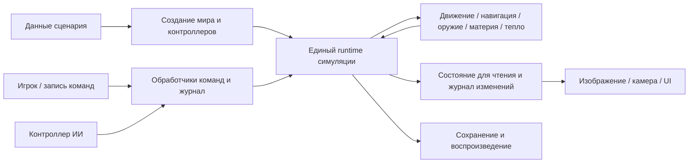

# План общего движка: производительность, устойчивость и сценарии как данные

## Актуальное состояние на 10.10.2026 — ревизия 242

Сверено с `main` / `0f4f13d`. [Полная сверка 242](242-plans-status-after-main-update.md)
обновляет [историческую матрицу 238](238-plans-status-and-next-steps.md) по выполненным
этапам [240](240-improvement-plan.md) и результатам [241](241-parallelism-and-gpu.md).
EP — общий план; A–G в 240 — его срезы, их задачи нельзя складывать с WBPERF/P.

Архитектура 12/12 и документы 3/3 прошли локально 10.10; P-74 закрыт.
Компонентное резервирование грунта, региональная готовность обвала, range filter
неподвижного ИИ, фиксированный физический пул и golden полигона уже реализованы.
Они не ставятся на повторное внедрение. Большие EP остаются частичными до полной приёмки.

Профиль 236/hash `bd7ada90567d88ab` исторический: после 644–661 физическое поведение
изменилось. Текущий закреплённый golden600 — `b5e87f81b44c681c`; это не новый Windows
прогон. Профиль 240/241 на Linux/4 vCPU даёт позднее среднее около 41–43 мс,
но относится к указанным там коммитам. Его нельзя сравнивать с Windows/8 workers
как ускорение. Цели канона: **каждый headless tick ≤33 мс; каждый native кадр
≤6,06 мс (165 FPS)**. Обе итоговые цели ещё не квалифицированы.

| Этап | Состояние | Что подтверждено | Остаток | Основание |
|---|---|---|---|---|
| EP-01 | Частично | Фазовые профили, manifests, счётчики группового приказа и причины отказа coarse существуют. | Возраст реальной старейшей работы, impact→commit→collapse→visible; новый Windows/native baseline после 644–661 и 0f4f13d. | 240 B1, 241 |
| EP-02 | Частично | Общий command executor, receipts/checkpoint/replay и owned exports HUD/части geometry/terrain. | Полный согласованный export всех product readers; внешний журнал inputs/acks и подключение CommandRuntime в окно. | 209–232, 242 |
| EP-03 | Не включено в продукт | Явный физический пул и ограничение долга реального времени добавлены; синхронный CommandRuntime есть. | Scene всё ещё синхронно вызывает profile.step; отдельный owner, publication/pacing, reset/cancel/save/shutdown/recovery не внедрены. | 240 B4/B5, blast.rs |
| EP-04 | Частично | Компонентные ground claims, ожидаемый материал, восстановление групп; собственные освобождённые слоты раньше дополнительных кусков, thermal reserve. | Длительный полезный прогресс при полном flying/working pool, точные retry/wake зависимости; отдельно наблюдать dusted по принятому контракту ADR-659. | ADR-659, 0f4f13d |
| EP-05 | Частично | Региональное удержание detach, немедленное обновление графа опор; fallback целым телом, parallel chunk labels и отсев плит. | Ограниченная стоимость повторных проверок удержанных групп, длинные/пересекающиеся опоры, возраст и дренаж очередей в длительном бою. | ADR-645, 240 G4 |
| EP-06 | Частично | Очередь валки и справедливая доля routine work существуют. | Компактный frontier, освобождение/wake и память, arrivals/completions/oldest age; новый длительный замер после C1/C4. | 234, 240 |
| EP-07 | Частично | Индексы запросов, sorting 236, wave unit boxes 661; pile_cell=16 принят как изменение правил 660. | Активные/dirty пути settled/support/rubble без удорожания запросов. F1/F2, F5 и G7 отклонены; повторять их без нового решения не следует. | 240 E/F/G |
| EP-08 | Частично | RON разбирается один раз, coarse reuse, ротация стартов, partial routes и исправление доворота; 17/18 начинают движение до 100 тиков. | Паук без чистого start corridor, динамическая fairness, цена узла fine search и полный command-to-visible. Бюджет поиска не снижать ради метрики тика. | 240 B1/B2/B6/C3/C5/F4 |
| EP-09 | Частично | Радиусы из battle-ai.ron; неподвижные установки фильтруют цели по attack_ranges; потолок волн делится между сторонами. | Общая исполнимость: LOS/баллистика, отказы и повторный выбор, мобильные цели/позиции; отдельная регрессия реального выстрела турели. | 240 B3/C2/C6 |
| EP-10 | Частично | Stable fragment slots, часть owned geometry/terrain и buffer reuse уже есть. | Все terrain/occupancy/distant/effects readers, coherent dirty publication, GPU-газ и новый native профиль/визуальная приёмка. | 231–232, 240–242 |
| EP-11 | Частично | Snapshot до 61 при ожидающих claims, стороны волн, checkpoint/replay, synchronous reset/epoch; golden боя 600 тиков в репозитории. | 30 минут боя, 20 reset/restart, attribution/transient peaks памяти; незавершённые работы и удержанные exports во всём async lifecycle. | 240 B7, blast.rs::snapshot |
| EP-12 | Частично | Основной путь выбран: BlastRange (657); gravity=98 согласована (658); общие команды/физика и данные сценария частично есть. | Миграция economy/build/reclaim/vision и consumers World, runtime owners/objectives, gun/battle контракт, data models; материал 64→5000 и paged 10 км. | ADR-657/658, 240 D |

## Следующий порядок и условия завершения

1. **Текущий baseline и полезный прогресс.** На новом контракте измерить весь tick,
   хвосты, oldest age, input→first motion→visible и impact→first/last commit→collapse.
   Не использовать старые NoRoom/backlog как текущие числа. Сохранять все повторы.
2. **EP-07/08/05/06 по остаточному профилю.** Дешёвые точные запросы и active/dirty
   поддержка settled/rubble; fine-search, старт широкого корпуса, held groups,
   компактная валка. F1/F2/F5/G1/G3/G7 отклонены: нужен новый механизм и замер,
   а не повтор уже отменённого патча. Острова G5 без доказанной границы не внедрять.
3. **EP-04 и EP-09: длительное поведение.** Полный pool, реальное освобождение,
   retry/wake, оба источника огня; LOS/баллистика, feedback отказов и фактический
   выстрел ИИ. `dusted` при split/no-room — принятая семантика ADR-659, её учитывать
   явно; ledger balance не доказывает отсутствие распыления.
4. **EP-02b/10 → EP-03.** Полный согласованный export, стоимость копирования и
   удержанных поколений; затем sim owner вне кадра с pacing/cancel/reset/save/shutdown.
   Ограниченный аккумулятор ADR-647 не заменяет отдельного owner.
5. **EP-11 через каждый срез.** Save посреди claims/waves/search/collapse; 30 минут
   боя, 20 reset/restart, memory attribution/transient peaks и consumer lag.
6. **EP-12: выбранное ядро становится общим продуктом.** BlastRange выбран ADR-657;
   миграция economy/build/reclaim/vision и старых consumers ещё не сделана. Runtime
   team/owner/objectives и общий gun path; затем data models, material 64→5000,
   paged мир 10 км. Q-76/Q-77 оставлены владельцу/playtest с текущими defaults.

Новая native приёмка проводится на каждом значимом продуктовом срезе и в конце:
30 Hz, одинаковые данные/качество, latency, все попытки, без диагностического capture.
Чистая оптимизация сохраняет результат; изменение физики требует своего принятого
контракта и переквалификации. Worker completion по wall clock не выбирает commit tick.

## История приёмки 201–237

Рекомендации «следующий шаг» и числа в записях ниже относятся к соответствующему
пакету; они не заменяют актуальную таблицу и порядок выше.

Пакет [234](234-artillery-terrain-admission.md), ADR-639: исправлена конкуренция
ожидающих воронок с валкой, тепловым прогнозом и wake. Свободную вместимость
делят две очереди, нечётное место чередуется по tick. Проверены реальные
surface craters от ИИ при продолжающейся валке, одноместный пул, ledger и
replay. Данные зарядов и ceilings не увеличены. EP-04b/06 продвинуты;
оставшиеся release/wait guards, дренаж очередей и исторические обходы
сохраняются в плане. Новая нагрузка требует отдельного baseline; прежние
FPS и физические hashes не являются приёмкой исправленного боя.

Итог234: 1045 headless/data и 166 UI tests без падений; 60 юнитов/3600 тиков,
snapshot3300→replay300 и один/восемь workers совпали. Ground claims выросли
40619→717763, фактически снятая почва от всего оружия — 728085→1450345.
Цена headless тика на восьми workers выросла: p50 13,015→24,007 мс,
p99 17,884→33,129 мс. Это новый функциональный baseline; native FPS ещё
не измерен. Остаются 11,48 млн capacity retries и 7 waves. EP-04b/06/07
и ограниченная публикация EP-02b/10 сохраняют открытые критерии приёмки.

Пакет [233](233-artillery-terrain-energy.md), ADR-638: исправлено отсутствие
воронки при артиллерийском попадании в машину. Общий материальный Explosion
игрока и боя применяет body_energy_pct: корпус не расходует долю почвы.
Резерв и общий остаток каждой волны восстанавливаются через snapshot59;
старые начавшиеся волны сохраняют прежнюю семантику. На штатной репродукции
подтверждённое снятие почвы выросло с 0 до 77018 ячеек за 600 тиков;
настоящий ИИ также разрушает грунт. Штатные полные запасы в данных
содержат прежнюю долю корпуса и отдельную долю грунта. Это намеренное
исправление физического поведения, прежний hash и одинаковая нагрузка
не объявляются сохранёнными. Все 1036 headless/data и 17 целевых artillery
tests, 165 UI tests и полный бой 60 юнитов/3600 тиков прошли. Replay 3300→3600
совпал, hash `91232229c4302cb6`; прежние четыре architecture failures/46
диагностик без добавлений. Сборка игры обновлена. Продвижение crater contacts
при насыщении pools остаётся отдельным измеряемым пунктом: полный прогон
оплатил 40619 ground claims, но 12 волн остались незавершёнными. Профили 215/232
относятся к прежним зарядам; новые оптимизации требуют измерений новой
физической нагрузки и отдельной проверки темпа боя.

Пакет [232](232-engine-owned-terrain-rows.md), ADR-637: начальное окно,
entering slabs и staging/repair terrain получают общий owned Row/Changes.
Raw материалы, ceilings и sparse work/cost принадлежат publication; packing
workers не читают мир. Request/Budget проверяются до копирования. Staging
сохраняет восемь строк за кадр; entering slabs ограничены колонками восьми
полных строк, поэтому узкие полосы группируются. Late changes/shadow uploads,
generation guards и repairs после смены costs сохранены/проверены.
Следующие границы — visible terrain patches/occupancy, distant/minimap,
затем остальные geometry/effects и общий coherent publication перед owner.
Полная приёмка 232: 1033 headless/data и 164 UI pass;
прежние четыре architecture failures/46 диагностик без добавлений. Явный
air-padding contract сохраняет окна вне мира; исходная staged-shadow/reset
регрессия и семь новых engine tests проходят без ослабления.
Late export восьми строк: reuse/capture/drop 2028,399/
2066,037/3,312 мкс,
logical batch 686528 bytes; это не RSS и не direct-copy speedup.
Три stock боя сохраняют 25 fields/hash и late replay; mean step
13,241→13,339/13,323 мс.
Заранее заданные три ordinary пары: медианы 69,9→68,7 FPS,
p99 33,562→33,587 мс; valid/eligible/tempo и gate 3% сохранены.
Отдельная camera-tour пара valid для диагностики, но не eligible/tempo:
3537/3566 тиков вместо 3600.
Staging и shift стали дороже; ускорение не подтверждено, подробные фазы
и первоначальный отказ агрегатора сохранены в 232. Native gate не ослаблен.
Устойчивое ускорение, полный export, owner/lifecycle, память поколений
и 165 FPS ещё не доказаны/не завершены.

Пакет [231](231-engine-owned-unit-geometry.md), ADR-636: damage meshing
и его кадровый coordinator получают owned View/Mesh общего движка.
Копируются metadata и bounded samples; body/segments/damage/config —
только для допущенных jobs, прежний лимит двух сохранён. Ключ моделей учитывает
unit resistance/role coefficients, включая настройку на паузе. Снимки не содержат
world references; stale generation/tick/config/revision/anchor отвергаются.
Следующий срез — bounded terrain column/row и surface changes с проверкой
staging repairs при скачках камеры. Затем gun/poses/occupancy, fragments,
bodies и effects; полная публикация и owner вне кадра остаются открытыми.
Проверки, стоимость раннего/позднего export и qualification — в 231.
1026 headless/data и 162 UI pass;
прежние четыре architecture failures/46 диагностик. На 60 units metadata
4120 bytes, поздний refresh 0,204 мкс;
mesh capture/drop 3,346/0,870 мкс,
private pair 671872 bytes без shared/capacity/BTree
node overhead. Три боя сохраняют все 25 fields/hash и late replay; mean
step 13,304→13,347/13,399 мс.
Первая финальная native пара не прошла FPS gate: 70,1→67,7 FPS (−3,424%).
Из-за разброса идентичного frozen control 67,1/70,1 FPS заранее объявлены
две дополнительные пары с переменой порядка, без изменения кода/порога.
Медианы всех трёх пар 68,5→70,2 FPS,
p99 33,699→33,342 мс проходят gate 3%, tempo/hash сохранены.
Первый отказ и все запуски включены в отчёт; первоначальный однопарный
критерий не пройден. Малую регрессию эти короткие серии не исключают.
Устойчивое ускорение и полная память поколений не доказаны; EP-02/03 и
165 FPS ещё открыты.

Пакет [230](230-engine-world-reset-lifecycle.md), ADR-635, закрывает
синхронный переход world/epoch/Inbox. Ошибки данных, stale epoch,
переполнение и отказ reserve сохраняют прежний мир и очередь; успешный
reset возвращает результаты старого поколения и явную отмену pending
команд/планов. Пул навигации переносится, равные authored размеры сохраняют
occupancy allocation. Product Scene использует общий reset и checked
generation; самостоятельный owner в игровое окно пока не включён.
Следующий срез — geometry/terrain readers и полный synchronous export
с измерением позднего copy/free/memory; затем owner вне кадра и async
reset/cancellation/publication. Durable retirement journal не добавлен.
Приёмка: 1020 headless/data и 160 UI pass; четыре старых architecture
failures/46 диагностик без изменений. Три боя сохраняют все 25 потиковых
полей/hash и late restore; mean step 13,323→13,389/13,460 мс. Ordinary
пара: 69,7→69,6 FPS, p99 33,342→33,148 мс, tempo/hash сохранены; gate 3%
пройден. Ускорение не доказано. Полная приёмка — в отчёте 230;
физический debt, EP-02/03 и 165 FPS остаются открытыми.

Пакет [229](229-engine-manual-gun-commands.md), ADR-634, закрывает ручные
команды орудия и патрули в общем ingress. Обычный полигон использует тот же
owner/checkpoint/ack; ScenarioRun задаёт прицел и патрули командами.
Busy сохраняет прежние эффекты отказа выстрела; invalid aim атомарен,
deadline не переполняется. Внутренние автоматические действия и lifecycle
не дублируют внешний capture. Следующие границы — reset/rebuild с epoch
и отменой jobs, geometry/terrain export, затем перенос owner из кадра.
Объединение физического gun path с actor и scenario runner остаются EP-12;
физические очереди и 165 FPS этим структурным переносом не закрыты.
Полная приёмка 229: 1013 headless/data и 159 UI-проверок прошли; прежние
четыре architecture failures/46 диагностик. Stock бой и late restore
совпадают по 25 потиковым полям/hash. Mean step 13,334→13,414/13,483 мс;
ordinary native пара 71,4→69,6 FPS, p99 33,201→33,575 мс, tempo/hash
сохранены. Допуск 3% пройден, но кандидат в паре медленнее; устойчивое
ускорение не подтверждено. Протокол и первоначальный отказ устаревшего
battle-only assertion описаны в 229.

Первый продуктовый срез EP-02b — [216](216-engine-hud-read-model.md): HUD,
roster, маркеры миникарты и её camera outline получают owned View общего
движка без Scene. Снимок не содержит геометрии и обновляется также между
тиками; reset меняет generation и удаляет старые slots. Это миграция части
реальных readers. Остальные UI/terrain/geometry readers, все writers и
threaded owner остаются открытыми; диагностический replay не включается
в кадровый путь. 890 headless и 139 уникальных render tests проходят;
четыре прежних architecture failures не изменились. На 60 units export
занимает 4960 bytes, mean 0,65–0,77 мкс в прогретом микрозамере. Три ordinary
пары сохраняют 3600 ticks/120 s и hash; медиана FPS 69,5→69,6, p99
33,867→33,867 мс. Устойчивого ускорения серия не показывает, цель 165 FPS
остаётся открытой.

Продолжение [217](217-engine-panel-read-model.md) переводит `panel::refresh`
на ту же owned публикацию: кнопки, разделы и подробный readout работают без
Scene. Подробный Inspection отделён от View и собирается только для открытого
потребителя; закрытая панель не обходит историю fragments и не форматирует
скрытый текст. Явный loadout отделён от effective weapon. 892 headless и
142 render проверки пройдены; физический hash и все 25 потиковых workload
полей прежние. Knobs, geometry/terrain и product writers остаются открытыми;
переход всего owner не объявляется выполненным. Три native пары сохраняют
tempo/hash; медиана FPS 71,3→72,3, p99 33,290→33,400 мс. Допуск пройден,
но третья пара медленнее control, устойчивое ускорение окна не заявлено.

Проверки [218](218-engine-rubble-flank-queries.md) и
[219](219-engine-fragment-geometry-table.md) отклонили индекс бортов для
rubble и таблицу геометрии малых форм: сокращение узкой работы не прошло
полный battle gate, рабочие изменения убраны. В
[220](220-engine-fragment-identity-transforms.md) общий Fragment::bounds
пропускает только точные тождественные масштаб и поворот. Четыре боя
сохраняют весь workload/hash; mean tick −0,16%, rubble −0,64%, debris
+0,38%, поздний tick +0,34%. Это небольшая экономия арифметики, не
доказанный устойчивый speedup боя и не закрытие EP-07. Historical gather,
active/sleep sets, capacity/progress и связь кадра с тиком остаются
приоритетными. Нельзя повторно объявлять 218/219 внедрёнными индексами или
выбирать следующий cache по одному microbench.
892 headless tests и late replay 3300→3600 прошли, 46 architecture
diagnostics прежние. Одна ordinary native пара: 74,6→73,9 FPS,
p99 32,854→33,155 мс при прежних tempo/hash. Рост FPS не подтверждён;
эта проверка не заменяет трёхпарную приёмку ускорения окна.

Пакет [221](221-engine-settings-read-model.md), ADR-626, переводит
`knobs::refresh` на owned Parameters общего движка. Закрытая панель не
запрашивает экспорт; открытая не разбирает sim.ron для каждой строки
отсутствующего шагохода. Все значения и paused/reset semantics сохранены.
894 headless и 292 render tests прошли; 25 потиковых workload fields и
hash четырёх боёв прежние, late replay пройден. Mean Parameters export
на 60 юнитах — 0,206–0,226 мкс, product payload — 2000 bytes. Это
ограниченный срез EP-02b: actions/apply и другие writers, geometry/terrain,
полная публикация и threaded owner ещё не перенесены. Четыре прежних
architecture failures остаются; экономия defaults не доказывает рост FPS.
Три ordinary пары: медиана FPS 74,6→74,4, p99 32,843→32,615 мс;
все шесть профилей valid/eligible, сохраняют 3600 ticks/120 s и hash.
Заданный допуск пройден, устойчивого ускорения окна нет.

Пакет [222](222-engine-motion-commands.md), ADR-627, переносит все 18
параметров ходовой в общий TuneMotion/Outcome и существующую переносимую
очередь. Найдена и исправлена потеря уже изменённых параметров при restore:
snapshot54 сохраняет разреженные отличия от defaults, нетронутые миры
сохраняют прежние байты/hash. Настройки переживают paused rebuild0→0 по
generation. Следующая часть writer migration — обломки/материалы/оружие
и lifecycle/setup; для каждого обязательны тесты pending checkpoint **и**
сохранения применённого состояния. Geometry/terrain readers и перенос
owner из кадра ещё открыты. 900 headless и 148 blast tests прошли; stock
workload/hash и late replay прежние. Три native пары сохраняют tempo/hash,
медиана FPS 72,8→73,0, p99 33,098→33,092 мс; gate пройден. Устойчивое
ускорение не доказано, четыре прежних architecture failures остаются.
EP-02/03 этим срезом не завершены. Для debris/material writer восстановить
tuning/registry до валидации физических очередей; weapon config пока
внешний аргумент restore — его владение тоже требует явного контракта.

Пакет [223](223-engine-debris-commands.md), ADR-628, переносит 14 настроек
обломков в TuneDebris и сохраняет всю Blast-конфигурацию до загрузки
физического состояния. Сохранённые лимиты используются при проверке очередей;
закрытая вместимость не открывается от restore, уменьшение MaxFlying не
удаляет материю. Нетронутые миры сохраняют прежний формат/hash. Следующие
writers — материалы/оружие и lifecycle/setup. Для плотности материалов
учесть существующие количества в ledger и проверку через per_voxel;
для оружия определить владение внешним config при restore. Geometry/terrain
и выделение owner ещё открыты. 907 headless и 150 blast tests проходят;
25 потиковых полей stock боя, hash и late restore 3300→3600 прежние.
Четыре архитектурных отказа и 46 диагностик не изменились. Одна native
пара сохраняет темп/hash: 72,6→72,3 FPS, p99 32,994→33,145 мс;
допуск 3% пройден, ускорение не показано. Полная приёмка — в 223.

Пакет [224](224-engine-material-commands.md), ADR-629, переводит прочность
и плавление материалов в TuneMaterial, pending checkpoint и snapshot56.
Свойства восстанавливаются до физических разделов; material/motion/debris
совмещаются, нетронутый мир сохраняет прежние bytes/hash. Плотность остаётся
отдельной незакрытой задачей: текущий writer меняет per_voxel, оставляя
Body/Debris containers со старыми количествами; loader и физические
переводы затем проверяют их по новой плотности. Нужен согласованный переход
учёта, включая существующие тела/обломки, claims и стоки, с bounded work
и replay; простого сохранения registry недостаточно. Оружие, lifecycle,
geometry/terrain и отдельный owner по-прежнему открыты. Прошли 966
headless tests (включая 53 проверки данных) и 152 blast tests; stock бой,
25 потиковых полей, hash и late replay прежние. Четыре архитектурных
отказа не изменились. Одна native пара: 71,8→71,6 FPS, p99
33,128→33,320 мс; темп/hash прежние, допуск 3% пройден, ускорение
не показано. Полная приёмка — в 224.

Пакет [225](225-engine-density-commands.md), ADR-630, закрывает live density
writer и рассогласование материи, оставшиеся после 224. Плотность грунта
применяется при confirmation извлечения; существующие Body/Fuel сохраняют
исходную базу, fragments — quantity/mass. Команда не пересчитывает историю
и не меняет initial/стоки. Snapshot57 хранит изменения и факт применения
после reset, чтобы сохранять смешанные кучи. Панель всех восьми материалов
использует TuneMaterial. Следующий writer — weapon config: общий command,
явный владелец конфигурации и pending/applied restore; затем lifecycle/setup
и geometry/terrain export до выделения owner. Прошли 976 headless/data и
154 blast tests; stock бой совпадает по 25
потиковым полям/hash и late replay 3300→3600. Четыре architecture failures
и 46 диагностик прежние. Одна native пара: 74,2→74,3 FPS,
p99 33,044→32,765 мс; темп/hash сохранены, допуск 3% пройден.
Ускорение не доказано. Полная приёмка — в 225; EP-02/03, физический
прогресс и native 165 FPS остаются открытыми.

Пакет [226](226-engine-weapon-commands.md), ADR-631, переносит live weapon
config, пресеты и мощность панели в ConfigureWeapon общего executor.
Snapshot58 владеет initial/current конфигурацией; portable checkpoint
сохраняет pending команды и их результаты. Исправлены четыре максимума UI,
превышавшие поддерживаемые loader bounds. Начальные лимиты мира и таблицы
оружия AI-акторов сохраняют прежний контракт. Следующий шаг — lifecycle/setup
writers и geometry/terrain export; после полного синхронного среза — owner.
Прошли 984 headless/data и 157 уникальных UI-проверок; единственный отказ
нового клавиатурного стенда исправлен и повторён отдельно. Все 25 полей
stock боя и late replay совпали. Native пара: 71,8→72,7 FPS,
p99 33,337→33,154 мс, tempo/hash прежние; допуск пройден, ускорение
не доказано. Четыре architecture failures и 46 диагностик прежние.
Приёмка и ограничения находятся в 226. Перенос настройки не закрывает
EP-02/03, физические очереди или цель 165 FPS.

Пакет [227](227-engine-battle-lifecycle-commands.md), ADR-632, переносит
запуск подготовленной расстановки, свободное управление, автономность обеих
сторон и смену боеприпаса в общий executor. Owner принимает Setup/Fighting,
checkpoint сохраняет очередь запуска; diagnostic replay учитывает команды
до проверки первого AI frame и отклоняет неверную запись до мутации.
Сценарные условия в движок не добавлены. Пересоздание мира, передача нового
epoch, AI tuning и ручное орудие остаются writers следующего среза;
geometry/terrain export нужен до отделения owner от кадра. Прошли 993
headless/data и 159 UI-проверок; четыре architecture failures и все
46 диагностик прежние. Stock бой и late replay совпали по 25 потиковым
полям/hash. Native пара: 70,5→70,6 FPS, p99 33,455→33,594 мс;
tempo/hash сохранены, допуск 3% пройден, ускорение не доказано.
Полная приёмка и ограничения — в 227; EP-02/03 целиком не закрываются.

Пакет [228](228-engine-ai-configuration-commands.md), ADR-633, переносит
настройки Rules в ConfigureEnemyAi. Принятый внешний план получает явный
Reconfigured при перезапуске цикла; очередь, checkpoint и diagnostic replay
согласованы с новым сроком решения. Исправлен отказ загрузки полной очереди
коротких команд из-за завышенного минимального размера записи.
Следующий срез writers — rebuild/epoch и ручное орудие; затем полный owned
geometry/terrain export до выделения owner. Предварительная доставка
внешнего плана до запуска остаётся отдельным контрактом. Прошли 1005
headless/data и 159 UI-проверок. Четыре architecture failures и все
46 диагностик прежние; stock бой и late replay совпали по 25 полям/hash.
Native пара: 69,5→70,4 FPS, p99 33,605→33,177 мс, tempo/hash сохранены.
Допуск 3% пройден; устойчивое ускорение не доказано. Полная приёмка —
в 228; EP-02/03, прогресс физических очередей и 165 FPS ещё открыты.

## История внедрения 201–214

Следующие записи сохраняют факты и рекомендации на момент каждого пакета;
текущий порядок задан выше и в таблице ближайших изменений.

Дата: 07.10.2026. Основание — [повторно проверенный аудит](199-engine-performance-audit.md) текущего рабочего дерева. Частичное внедрение EP-01/EP-04a/EP-09 описано в [первом пакете изменений](201-engine-performance-first-implementation.md), сокращение ненужной подготовки внутри вызова EP-04b — во [втором](202-engine-wave-lazy-geometry.md) и [третьем пакетах](203-engine-ground-continuations.md); производный индекс точных rectangle queries EP-07/08 — в [четвёртом пакете](204-engine-rubble-rectangle-index.md); фазовый поиск корпуса для push/wake EP-07 — в [пятом](205-engine-debris-hull-index.md). В [проверке 206](206-engine-roof-support-queries.md) roof index, включая адаптивный вариант, отклонён battle gate и полностью убран. В [пакете 207](207-engine-compact-wake-actions.md) принят компактный список wake actions с прежними predicates и ordered admission. Ни один крупный этап целиком не закрыт. Существующий [бэклог WBPERF](118-world-battle-performance-backlog.md) сохраняет историю; EP — последовательность внедрения и уточнение приёмки, а не второй независимый список закрытых задач.

Статус внедрения: добавлены суммы фаз и часть queue metrics, общий capacity cache всей фазы валки, наблюдение реальных weapon capabilities и предварительный счёт focus fire. Волны теперь строят narrow-phase карты только посещаемым акторам и не готовят геометрию после heap slice без pending contacts. Пакет 203 также исключает bounds/partition для очереди, в которой saved cursors доказывают завершение всех body prefixes; старые point-sampled волны проверяются строже. Порядок/квоты/физическое состояние сохраняются; физические retries продолжаются, вместимость этим не освобождается. Новая автоматическая политика неподвижных орудий не прошла проверку активности всей армии и убрана; её завершение зависит от протокола освобождения физической вместимости EP-04b/c: причинная трасса 202 подтвердила нехватку шести мест после двух ранних картечей и отдельные интервалы наведения/смены цели. Пакет 204 сохраняет sorted rubble columns и добавляет exact bounds/max индекс для rectangle queries общей навигации; gather, активные наборы и source-order wake прежние. Пакет 205 добавляет пространственный индекс корпусов только для push/wake с прежним первым точным контактом, source-order admission и thermal/claim reserves. Средние двух контролей и двух новых боёв дают debris −4,5%, tick −0,9%; первый прототип не прошёл gate и доработан. После отклонённого roof index 206 пакет 207 сокращает пустые ответы и commits wake с прежними predicates/reservations; wake −13,7%, debris −3,2%, tick −1,0% относительно 205. EP-02/03 и прочие части плана остаются открытыми. Паспорта, контрольные цифры, сохранённые прототипы и оставшиеся отказы проверок — в отчётах 201/202/203/204/205/206/207.

Повторная ревизия плана: крупные этапы разделены на внедряемые части, уточнены фазовый порядок команд, представление мира для рендера и условия завершения физических очередей. Числа ниже относятся к прежним замерам аудита; новая проверка плана не является новым замером скорости.

Уточнение после 206/207: перенос roof scans на дерево не принимается по одному raw microbench. Адаптивный вариант 206 дал tick +0,44%, debris +1,56% и был убран. В 207 сокращены плотный временный массив ответов и пустой ordered commit wake: четыре полных AI runs дают wake −13,7%, debris −3,2%, tick −1,0%, при прежних 25 per-tick workload fields и replay. Полный predicate scan, Settled и historical gather ещё сохраняются. Следующий шаг EP-07 должен отделить цену этих обходов и строить active/sleep sets с устойчивыми slots и прежними reservations. Пороги и новые обёртки сами по себе не доказывают отсутствие overhead. Приоритет EP-02a/02b/03 и EP-04b/c сохраняется.

Уточнение после [208](208-engine-translation-experiments.md), ADR-614: три варианта translation storage проверены в 12 полных AI runs и отклонены. Fixed compact outputs дали tick +1,06%, active input +1,24%, persistent dense scratch +0,12%, хотя два последних немного ускорили саму translation. Рабочая физика восстановлена к 207, новых active sets или scratch в ней нет. Малая разница третьего не доказывает причинной регрессии, но не подтверждает ускорения полного шага и не оправдывает удержание буфера. Следующим изменением не должен быть ещё один collector wrapper: EP-02a/02b/03 и EP-04b/c сохраняют приоритет; EP-07 требует измеренного сокращения полной работы исторического roster.

Паспорт отката проверяет не только source hashes, но и фактически собранный executable. При Copy-Item из backup старая LastWriteTime может заставить Cargo использовать более новый cached prototype, хотя source bytes уже восстановлены. После restore обновлять даты всех возвращённых исходников, проверять реальную пересборку, повторять tests/replay и отдельно фиксировать SHA нового binary. Несовпадение такого паспорта блокирует приёмку; совпадающий игровой hash сам по себе stale build не исключает. Этот случай воспроизведён и исправлен при откате 208.

Пакет [209](209-engine-shared-order-handler.md), ADR-615 — первая структурная часть EP-02a: общий внутренний kernel приказов игрока/ИИ, общая валидация и финальный commit формации с прежним бюджетом поиска. 850 nav/sim-core tests и replay 3300→3600 прошли, четыре AI battles сохраняют полный workload/hash. Средний tick +0,11%, AI scope +0,250 мкс/tick — в заранее заданной цене adapter; ускорение не заявлено. Общий journal/envelope, остальные writers, read model и sim owner ещё не реализованы; EP-02a остаётся частичным.

Пакет [210](210-engine-command-receipts.md), ADR-616 добавляет типизированный синхронный вход, явные результаты и ограниченную запись исполнения; formation queue теперь в общем executor. 854 tests, пять полных боёв (включая capture) и late replay сохраняют физику. Default tick −0,39% не заявлен как устойчивое ускорение. Capture диагностический, не авторитетный journal; delivery/scheduling/ack и остальные writers/read model/owner остаются следующими задачами EP-02a/b/03.

Пакет [211](211-engine-command-runtime.md), ADR-617 реализует ограниченный внешний вход боевых приказов в синхронный owner того же BlastRange: epoch/producer/sequence, assigned tick, CommandId с поколением, удерживаемый результат и явный Full. Drain перед физикой, ИИ AfterMotion; checkpoint в памяти/hash включают Inbox. 861 tests и 11 полных боёв сохраняют физику, replay с 1024 pending requests прошёл. Confirmation mean tick 13,214→13,141 мс укладывается в gate; устойчивый speedup не заявлен, шумный control с пиком 215 мс сохранён в отчёте. UI не мигрирован. Следующая часть EP-02a — переносимый journal, whole-plan AI delivery/fallback и остальные writers; затем read model/export EP-02b/03a, threaded owner/lifecycle EP-03b/c. Полный этап и native FPS ещё открыты.

Пакет [212](212-engine-ai-plan-delivery.md), ADR-618 добавляет whole enemy plan delivery в того же owner: общий Rules::whole_plan, атомарный validator, shared IDs/sequence/capacity, удерживаемые selected/fallback Outcomes и отмена будущего плана при завершении боя. Pending/completed checkpoint в памяти сохраняет результаты. 869 tests и восемь полных боёв прошли; stock tick 13,193389→13,196574 мс (+0,024%), physical hash/workload прежние. Direct/owned external inputs, snapshots и pending replay 3300→3600 равны. External planner наблюдает мир раньше AfterMotion и даёт другой workload; его timings не сравниваются со stock как ускорение. Portable journal/replay без policy, остальные writers/UI и read model/threaded lifecycle ещё открыты. EP-02a/WBPERF-002/016/020 остаются частичными, четыре прежних architecture failures и native FPS не закрыты.

Пакет [213](213-engine-command-checkpoint.md), ADR-619 закрывает переносимый checkpoint синхронного owner: отдельный versioned формат physical world + Inbox, строгие lengths/tags/bool, checksum, caller bounds и semantic restore guards. Runtime hash layout и physical save/golden прежние. 879 tests, восемь полных боёв и две file roundtrips в новых процессах прошли. Stock tick 13,183753→13,195718 мс (+0,091%); workload/hash и memory/portable replay 3300→3600 равны, включая 221 plan receipts или 1024 pending requests. На late whole-plan world encoder/decoder дали 117/115 мс в одной пробе; это вне step и без полного physical restore, не дешёвый render export. История acked inputs/results и replay без policy ещё не реализованы. Следующий шаг EP-02a — event journal, затем остальные writers/UI и read model/threaded lifecycle. EP-02a/WBPERF-002/016/020, native FPS и четыре прежних architecture failures остаются открытыми.

Пакет [214](214-engine-ai-decision-replay.md), ADR-620: общий one-step AiFrame capture/replay обеих сторон в AfterMotion без внутренней policy. Отсутствующий/лишний/несогласованный кадр отклоняется до мутации; portable codec ограничен aggregate actor ceiling; будущая лента принадлежит caller, transient hook очищается и не теряется при checkpoint. 886 tests, девять полных боёв; workload/hash прежние, три replay 3300→3600 равны, два новых процесса получили побайтно равные конечные owner saves. Stock mean 13,178860→13,149324 мс (−0,224%); structural gate пройден, устойчивый speedup не заявлен. Важное ограничение: диагностический полный pre-step hash позднего мира даёт около 414 мс на recorded AI step; API не включён в обычный бой. Следующий production event journal должен обходиться без полного world hash на каждой AI-фазе и иметь bounded sink/backpressure до authoritative мутации; offline hash guard остаётся отдельной проверкой. История новых external inputs/results/acks, writers/UI/read model/threaded lifecycle и native FPS открыты. EP-02a не закрывается этим primitive.

## Какой результат нужен

Один авторитетный runtime должен одинаково исполнять движение, оружие, разрушение, тепло, навигацию и сохранение для полигона, схватки, большой карты, ручного управления и ИИ. Сценарий задаёт начальный мир, сущности, команды/владельцев, подключение контроллеров и декларативные условия миссии. Он не выбирает специальную физику, бюджет контактов, обход препятствий или способ публикации в рендер.

Успех имеет три независимых измерения:

1. Кадр укладывается в согласованный бюджет и не ждёт целого тика симуляции.
2. Авторитетная симуляция выполняет 30 тиков в секунду без накопления долга времени.
3. Приказы, урон, валка, обрушение и пробуждение обломков действительно продвигаются; ускорение не покупается остановкой этих работ.

В историческом аудите до 201–214 средний headless-тик около 17,5 мс, поздний — 22 мс; ordinary native — 50,17 FPS и 0,969× темпа. Актуальные 13,149/16,570 мс и 70,87/68,37 FPS приведены выше: оптимизации уже помогли, но связь кадра с тиком и накопление физической работы сохранились. Нынешние шаги должны сокращать эти причины и зависимость обслуживания от всей накопленной истории. Выбор приказов ИИ сам по себе занимает слишком малую долю, чтобы устранить проблему FPS.

## Целевая граница систем

Это границы владения, не требование создать отдельный crate для каждого прямоугольника. Начать следует с пользовательского пути `BlastRange`, сохраняя работающие общие модули. Создание третьей симуляции рядом с `BlastRange` и `sim_core::World` только увеличит расхождение.

Общность проверяется уже на первых изменениях: один обработчик команд и одинаковое исполнение физики при одинаковых данных. Переименование `BlastRange`, новый универсальный ECS, снятие предела 64 или полное слияние со старым `World` не являются условием первого выигрыша. Таблицу возможностей двух путей составить в начале миграции, чтобы не потерять экономику, строительство, навигацию и другие механики старого пути; переносить их по потребителям, а не одним переписыванием.

| Контракт | Обязательное содержание |
|---|---|
| Идентичность | Устойчивый entity ID и generation; сторона/владелец в runtime, без `layout.units[id]` как источника текущего состояния |
| Команда | Источник, sequence, целевые tick и фаза, ID/generation акторов, содержимое; раздельные результаты приёма и применения, общая валидация игрока и ИИ |
| Наблюдение ИИ | Доступное контроллеру состояние, мобильность, реальные возможности оружия, цели миссии; версия и tick наблюдения |
| Исполнение тика | Фиксированный порядок фаз и стабильный commit; фиксированные пулы и работа в детерминированных единицах |
| Публикация | Согласованный generation/tick и manifest ревизий поз, геометрии и terrain; потребитель не смешивает произвольные версии разных тиков |
| Сохранение | Все авторитетные очереди, продолжения, владение материей, контроллеры, команды и порядок; render caches не обязательны |
| Миссия | Общие декларативные цели и подписка на события; победа не зашита в наличие физического `Base` |

Часы допустимы для профиля и внешнего pacing. Число выполненных физических операций и итог тика не должны зависеть от wall time, FPS, камеры, очередности завершения jobs или скорости GPU.

## Приоритеты и зависимости

Оценка размера: S — локальная правка; M — несколько модулей; L — контракт и миграция подсистемы; XL — несколько самостоятельных изменений. Это не календарные обещания.

| Этап | Приоритет / размер | Зависимости | Связь с WBPERF | Проверяемый результат |
|---|---|---|---|---|
| EP-01. Минимально полный стенд | P0 / M | Нет | 001, 027 | Время всех фаз, прогресс очередей, воспроизводимый ordinary профиль |
| EP-02a/b. Командный вход и состояние для чтения | P0 / M + L | Baseline есть; b не ждёт полного durable journal | 002, 016, 020 | Все product writers через owner; рендер читает immutable model |
| EP-03a/b/c. Проверка публикации; поток; lifecycle | P0 / M + L + M | Все writers/readers EP-02, gate EP-03a; полный архив событий не prerequisite | 002 | Кадр не ждёт тик; стоимость экспорта и задержка также ограничены |
| EP-04a/b/c. Учёт вместимости; retry; fairness | P0 / M + M + L | EP-01; b после доказанного a | 017, 005 | Меньше пустой работы; явные условия прогресса и конечной вместимости |
| EP-05. Локальные транзакции обрушения | P0 / XL | Контракт ownership/reservation EP-04 | 028 | Независимые компоненты продвигаются; нет миллионного разового дренажа |
| EP-06. Устойчивая очередь валки | P0 / L | Контракт capacity/retry EP-04 | 026 | Компактный фронт, справедливое обслуживание и видимый возраст |
| EP-07. Активная физика и инкрементальный rubble | P0 / XL | Lifecycle учёт EP-04a | 005, 011 | Меньше обходов истории при сохранении порядка admission и wake |
| EP-08. Пространственная навигация и приказы | P0 диагностика, P1 изменение / L | EP-01; EP-02a для общего ввода | 003, 004, 016 | Меньше подготовки соседей, измеримая задержка начала движения |
| EP-09. Допустимые цели и масштабируемый ИИ | P0 корректность, P1 масштаб / M | Существующие tests/capabilities; capacity-причины EP-04; EP-02 не блокирует | 022 | Исполнимые цели и реальная активность; текущий preprocessing не теряется |
| EP-10a/b. Текущая публикация; интеграция нового протокола | P0 / M + L | a — EP-01; b — EP-02b | 006–009, 013–015, 019, 020 | Ограничена работа по кадру и возраст видимых изменений |
| EP-11a/b. Память сейчас; lifecycle нового runtime | P1 / M + L | a — нет; b — соответствующая миграция | 018, 023, 025 | Бюджет памяти известен до смены хранения; save/reset проверяются с первого перехода |
| EP-12. Завершение общего runtime и масштаб | Общность — с первого этапа; масштаб P2 / XL | Контракты EP-02; остальные по готовности | 024 и общая архитектура | Сценарии только данные; большие армии на том же игровом пути |

EP-03 и EP-04 решают разные проблемы. Не следует ждать завершения всего переписывания потоков, чтобы исправлять admission. Узкую ошибку допустимости целей EP-09 также можно исправить раньше, но её FPS нельзя сравнивать с прежним менее активным боем как чистое ускорение.

P0 означает важность результата, а не необходимость одновременно начать все крупные задачи. Ближайший порядок работ приведён в конце плана. Внутри каждого этапа первая часть даёт проверяемый результат и допускает остановку/откат без обязательной реализации следующих частей.

## EP-01. Закрыть пробелы измерения и остановить бесконечное добавление профайлеров

**Статус 10.10 / 242: Частично.** Возраст реальной старейшей работы, impact→commit→collapse→visible; новый Windows/native baseline после 644–661 и 0f4f13d.
Выполненные части перечислены в текущей таблице; исходная диагностика ниже историческая.

Места: `bench_battle`, `scripts/profile-range.ps1`, `scripts/analyze-range-profile.py`, существующие наблюдатели `BlastRange` и render timeline.

Состояние 08.10: фазовые суммы, invariant CSV/locale и ordinary baseline уже
реализованы и проверены. Ниже сохранён полный контракт стенда; это не список
повторного внедрения. В текущем headless trace объяснено 98,44% времени,
остаток явно обозначен. Для очередей ещё нужны настоящий oldest age и причины
ожидания: возраст текущей головы и размер набора не заменяют эти показатели.

- Добавить в tick CSV суммы всех основных фаз с кратностью: волны, capture, flight, heat exchange, unit fire. Вложенные scopes сохранять отдельно, с родителем и единицами. Отчёт должен отличать среднее на вызов от среднего на тик.
- Добавить возраст старейшей работы, arrivals/completions, полезные применения, отказы и причины для collapse, felling, wave contacts, kinetic continuations, wake и navigation. Число записей, клеток, источников и попыток не смешивать.
- Записывать полный паспорт: source/data hashes, build context, actual physics/navigation/compute workers, разрешение, present mode, фокус, камеру и режим захвата. Исправить invariant CSV и добавить проверку `ru-RU`.
- Для редкого фриза использовать уже существующие триггеры/timeline; при неатрибутированном пике снимать стек и scheduler evidence. Не объявлять `wall − caller CPU` ожиданием mutex или простоями всех потоков.
- Зафиксировать ordinary baseline и минимальную матрицу ниже. После этого переходить к изменениям, а новые scopes добавлять только для конкретной неразрешённой гипотезы.

Приёмка: сумма неперекрывающихся фаз объясняет не менее 99% времени диагностического шага либо явно маркирует остаток; полная запись не теряет ticks/spans; арифметика проверяется на искусственном вложенном примере. Ordinary-приёмка отключает дорогую диагностику. Исправление локали не меняет числовой смысл старых записей.

Телеметрия не должна становиться новым авторитетным состоянием ради аудита: observation counters/часы не влияют на решения и hash. Если возраст впоследствии нужен для fairness, он становится отдельным детерминированным полем с правилами save/restore. Для старого сохранения неизвестный enqueue tick нельзя выдавать за измеренный нулевой возраст. Существующие hashes и build manifests переиспользовать; дополнять только отсутствующие поля.

## EP-02. Отделить намерение игрока и ИИ от изменения мира

**Статус 10.10 / 242: Частично.** Полный согласованный export всех product readers; внешний журнал inputs/acks и подключение CommandRuntime в окно.
Выполненные части перечислены в текущей таблице; исходная диагностика ниже историческая.

Места: `crates/render/src/bin/blast.rs`, `blast/panel.rs`, `range_battle.rs`, `range_ai.rs`, snapshot/restore.

**EP-02a — общий протокол без перестановки фаз.** Ввести общие обработчики и журнал команд поверх нынешних методов. Внешний ввод дренируется на объявленной границе tick, но встроенный ИИ остаётся в своей нынешней фазе: [battle_ai_tick](../../crates/sim-core/src/range_battle.rs) вызывается после движения, перед `battle_orders`. Перенос его решений в начало того же тика меняет наблюдаемый мир и задержку движения; это отдельное изменение поведения, а не прозрачный command adapter.

Первый реализованный шаг — [209](209-engine-shared-order-handler.md), ADR-615: общая валидация и применение существующих боевых приказов игрока/ИИ, общий финальный commit формации с прежним budgeted queue_move. Режимы ручной замены и поддержания решения сохраняют различия повторных приказов и rubble snapshots; scheduler и фазы прежние. Это структурная подготовка; EP-02b/03 не закрываются этим handler.

Пакет [210](210-engine-command-receipts.md), ADR-616 добавил типизированный синхронный вход игрока, результаты admission/application, formation queue в общем executor и ограниченную диагностическую запись фактических приказов. В ней есть tick/phase/producer/sequence сессии, выбранный внешний приказ ИИ и fallback; переполнение явно отмечается без потери физической работы. Clock увеличивается в конце step: phase отличает BetweenTicks/AfterMotion при одинаковом tick. Trace остаётся наблюдением, не авторитетным переносимым журналом.

Пакет [211](211-engine-command-runtime.md) реализовал envelope, generations/IDs, последовательности producers, bounded scheduler/drain и ack в синхронном owner общего мира. Пакет [212](212-engine-ai-plan-delivery.md) добавил whole enemy plans и удерживаемые результаты выбора/fallback; восстановление ожидающего плана и terminal cancellation проверены. Правила остаются в AfterMotion, внешний план не дробится player budget. Rules::whole_plan заполняет живых невыбранных actors в общем модуле, чтобы сценарии не дублировали это правило. Общий checkpoint/hash включает Inbox; [213](213-engine-command-checkpoint.md) добавил его versioned byte representation и загрузку в новом процессе. Это сохраняет текущие pending/results/watermarks, но не историю acked событий. [214](214-engine-ai-decision-replay.md) добавил portable phase frames обеих сторон и offline replay без внутренней policy. Полного event journal ещё нет: новые external inputs и ack доставляет caller. Его production path не должен сериализовать весь мир для hash на каждом AI deadline; сначала дешёвая связь stream generation/ordinal/checkpoint boundary и bounded sink/backpressure. Полные hash проверки сохраняются отдельно с явной измеренной ценой. Оставшиеся writers/UI и синхронный read model/export EP-02b выполняются без ожидания полного durable journal. Для переноса owner по EP-03 необходимы полный product command boundary, проверка публикации и явный контракт включённого режима записи; production journal с компактными state boundaries развивается отдельным срезом. Не закрывать этап по trace CSV, portable checkpoint или одному owner adapter.

У команды фиксировать requested tick, фактически назначенные tick/phase, producer ID и sequence. Внутренний контроллер выполняется по simulation clock; отдельный AI thread для нынешних микросекундных `Rules::decide` не нужен. Общность означает одни обработчики и валидацию, а не обязательный межпоточный канал между функциями одного владельца.

Порядок ID/sequence решает только порядок **уже принятых** команд. Он не делает воспроизводимым момент прихода внешнего/асинхронного плана. Существующий `submit_enemy_ai_plan` с `decision_tick`, отклонением позднего плана и fallback сохранить; записывать принятый результат или факт fallback. При command replay использовать запись без повторного запуска того же контроллера, при проверке детерминизма ИИ — одинаковые observation/config и scheduler. Запоздалые, дублированные и повторно присланные команды имеют явную семантику. Состояния «доставлена», «прошла валидацию», «применена» различаются.

Перевести UI, массовый приказ, demo sequence и ИИ на этот вход. Aim/fire отдельной пушки тоже выражать командами. Дедупликация повторных приказов допускается только при сохранении их смысла и подтверждений. На переходе адаптер может исполнять очередь синхронно в прежней фазе, чтобы отдельно проверить семантику до изменения потоков.

Инвентаризация writers включает также [knobs::apply](../../crates/render/src/bin/blast/knobs.rs), placement/workbench, смену оружия/материалов/ходовой, переключение контроллера, начало/завершение боя и reset. Сейчас knobs меняют в том числе `motion`, debris tuning и material registry: перенос только Move/Attack оставит обход нового владельца. Игровые настройки применяются атомарной валидированной командой на объявленной фазе и входят в replay; настройки картинки остаются у рендера. Данные команды содержат уже квантованные целые/Fx значения, а не повторный расчёт из UI-float. Изменение cap ниже существующих reservations не удаляет материю: операция либо отклоняется, либо использует отдельно определённый безопасный переход.

Частые намерения ввода можно объединять только до принятия команды и с определённой семантикой; принятые Fire/Stop/изменения режима не теряются при coalescing. Проверить переполнение и ограниченный дренаж больших групп: один клик на сотню акторов не должен обходить общий work budget незаметной внутренней петлёй. Для каждого типа команды определить атомарность группы, порядок и правила отмены; длительное построение маршрута остаётся continuation, а не выполняется целиком при приёме.

**EP-02b — полный перечень читателей и модель представления.** Для UI нужны здоровье, боезапас, приказ, статус, поза, видимая ревизия и результаты команд. Но этого недостаточно для выделения потока: [moving::occupancy](../../crates/render/src/bin/blast/moving.rs) читает материал земли под освободившимся корпусом, [witness](../../crates/render/src/bin/blast/witness.rs) — повреждённую геометрию, [fragments](../../crates/render/src/bin/blast/fragments.rs) — физические куски и шаблоны секций. Отдельно перечислить terrain/streaming/minimap, щиты, следы оружия и источники газа. Для каждого чтения задать владельца данных, revision, размер экспорта и условия обновления.

Модель рендера содержит достаточные immutable данные для этих операций; она не является полной копией симуляции. Сначала перевести читателей на неё в синхронном режиме. Пригодность публикации измеряется на разрушенном позднем мире и движении камеры, а не только на позах неповреждённых машин. Selection/picking использует видимое представление с последующей валидацией ID/generation при выполнении; обработчик клика не читает mutable физику.

Приёмка: записанный поток **принятых команд с tick/phase** воспроизводится headless и с графикой; разные FPS/камера не меняют физическое состояние на одинаковых тиках. Сохранены точки наблюдения/применения нынешнего ИИ. Команды со stale generation, уничтожением цели в тот же tick, групповым движением и конфликтующими источниками имеют явные тесты. Контракт генераций может сначала оборачивать существующие slots — новый entity allocator не обязателен. Архитектурная проверка запрещает обход обработчиков из UI; setup/reset имеют отдельный lifecycle-протокол.

Основная защита границы — типы и владение: продуктовый рендер получает read model и command sender, а не `&mut BlastRange`. Нынешняя architecture-проверка ищет запрещённые вызовы/присваивания по тексту; она не заменяет ограничение API и может пропустить мутацию через переданную ссылку. При переходе обновить её и тест `tick_coordinator_does_not_enter_the_shared_render_compute_executor` под новый контракт, сохранив исходный смысл — координатор не занимает общий render compute worker. Удаление старой проверки без новой гарантии не считается миграцией.

## EP-03. Исполнять симуляцию независимо от кадра

**Статус 10.10 / 242: Не включено в продукт.** Scene всё ещё синхронно вызывает profile.step; отдельный owner, publication/pacing, reset/cancel/save/shutdown/recovery не внедрены.
Выполненные части перечислены в текущей таблице; исходная диагностика ниже историческая.

**EP-03a — проверка границы до смены владельца.** Измерить на 60 юнитах и позднем сохранении экспорт EP-02b: wall time, bytes/tick, high-water памяти, срок жизни старых страниц и reclamation. Сравнить старый render input с новым в одном потоке и на тех же физических состояниях. Если новый путь делает полный clone мира, возвращается к чтению `Scene.sim` или создаёт длинные паузы освобождения, сначала исправить эту границу через EP-10; переносить её на поток преждевременно.

**EP-03b — отдельный владелец.** `SimulationRuntime` владеет mutable-миром на одном постоянном потоке и использует существующие фиксированные physics/navigation pools. Перед переносом проверить `Send`/lifetime у всех полей и исключить Bevy assets из kernel. Рендер читает опубликованные данные и не вызывает `step` в Update. Учитывать совместную нагрузку sim coordinator, physics/navigation, Bevy compute/async и render; увеличение числа пулов не считается решением. Отдельный поток даёт независимость исполнения, но не гарантию FPS при общей нехватке CPU.

Это не `Arc<Mutex<BlastRange>>`, который рендер блокирует на весь тик, и не ежетиковое копирование save snapshot размером 128 MiB. Нужны компактный двойной/тройной буфер поз и неизменяемые страницы геометрии с версиями; изменения страниц публикуются через журнал. Стоимость построения и освобождения публикаций также измеряется и ограничивается.

Presentation pages могут быть производной структурой поверх нынешнего voxel world; для этого не обязательно заранее выполнять всю страничную миграцию authoritative мира EP-12. Но размер страницы, COW amplification и число удерживаемых поколений требуют измерения. Рендер атомарно выбирает manifest завершённой публикации; при недостающей terrain/geometry revision продолжает показывать согласованное прежнее состояние. Нельзя незаметно соединять позы T, землю T−3 и возвращённый mesh от другого поколения мира.

Интерполяция имеет явно измеренный буфер времени: при обычной паре завершённых тиков это примерно один tick дополнительной визуальной задержки. При отставании симуляции alpha ограничивается, экстраполяция через неизвестные столкновения не применяется. Публиковать отдельно simulation lag, publication lag и interpolation delay: формулировка «последний tick без задержки» не должна скрывать этот буфер.

Различить виды информации:

| Данные | Допустимое поведение при отставании рендера |
|---|---|
| Промежуточная поза | Можно заменить более новой, сохранив нужные endpoints интерполяции |
| Полное состояние страницы | Можно объединить изменения до последней ревизии, если потребитель получает согласованную базу |
| Уничтожение/создание, геометрия и другие результаты физики | Восстанавливаются из согласованного актуального состояния с tombstones/generation либо из полного delta; их нельзя потерять из authoritative мира |
| Результат принятой команды | Sequence и ограниченный набор неподтверждённых результатов; повторный запрос не применяет команду дважды |
| Кратковременный визуальный эффект | В обычном режиме сохраняется последовательность событий; после длительного разрыва требуется явное правило восстановления, а не воспроизведение всех старых вспышек разом |

При переполнении входного канала новые команды получают явный отказ/повтор или backpressure на стороне producer; принятые команды не исчезают. Отставание **выхода рендера** не меняет admission физики и не блокирует её на ожидании ack. Для изображений допустим переход на согласованный свежий checkpoint; состояние уничтоженных объектов восстанавливается корректно, старые косметические эффекты обрабатываются отдельно. Нормальную видимую детализацию не уменьшать ради FPS. Если источник не подтверждает результаты, ограничить его новые outstanding-команды, не останавливая уже работающий мир.

Нельзя одновременно гарантировать бесконечное зависание потребителя, ограниченную память и бессрочную доставку каждого визуального события. Recovery — протокол представления, а не потеря физического состояния. Число удерживаемых страниц и отложенное освобождение также ограничены; большой `Arc` drop на sim/render thread не должен создавать новую паузу.

Порядок завершения jobs не меняет порядок commit. Нельзя принимать «те результаты, которые успели за 4 мс». Нормальная скорость задаётся 30 Hz снаружи; сама физика потребляет детерминированный объём работы. Увеличенный авторитетный tick требует оптимизации, даже если независимый кадр его скрыл.

**EP-03c — lifecycle и новый профиль.** Pause/resume/reset/save/shutdown обрабатываются владельцем на согласованной границе; jobs старой generation не публикуются в новый мир. При перегрузке часы pacing сохраняют долг; длительная пауза пользователя учитывается как явная пауза, а не потерянные тики. Существующий profiler считает `simulation_ticks` внутри Update: после переноса нужна новая версия схемы, где started/completed/published/observed ticks различаются. Core spans связываются с sim tick и общей monotonic epoch, frame spans — с реально прочитанной публикацией. Нельзя приписать длительность фонового тика целиком кадру, который заметил его результат.

Отдельно проверить неуспех: закрытый канал, panic/ошибка sim worker, устаревший или неудачный mesh job, отмена загрузки и ошибка записи save. UI различает «идёт работа», «пауза» и «владелец завершился с ошибкой»; последний опубликованный кадр не выдаётся за продолжающуюся игру. Ошибка render job не отменяет физический результат. Pause/resume/window focus/сворачивание/сон ОС имеют явную политику pacing: исключённые интервалы отражаются в профиле, после возврата нет случайного гигантского catch-up и скрытого стирания долга активного боя. Это требования нового lifecycle, не утверждение о воспроизведённых нынешних сбоях.

Приёмка:

- При искусственно задержанном sim tick кадр продолжает читать последний завершённый результат и обрабатывать UI; нет ожидания тика на main/render thread.
- Разные render FPS, пауза камеры и отключённый рендер дают одинаковое состояние на одинаковом tick для одного потока команд.
- Command ack виден без блокировки; фактический tick применения измеряется. Предлагаемый исходный SLO обычной принятой команды — следующий назначенный tick, без скрытой очереди на десятки тиков; дорогой поиск пути измеряется отдельно.
- Проверены смерть/respawn, damage mesh, смена карты, reset, сохранение, долгое отставание и восстановление потребителя, shutdown без висящих jobs.
- Прослежены все читатели EP-02b; нет спрятанного обращения к авторитетному миру из streaming/picking/mesh build. Замедление или полная остановка потребителя не меняет физические snapshots на одинаковых ticks. Пики экспорта, удержанной памяти и освобождения попадают в профиль.
- Старый синхронный и новый threaded adapters временно используют **один** kernel для differential проверки. После приёмки удалить временное раздвоение продуктового пути; rollback не должен зависеть от необратимой миграции сохранений в том же изменении.
- Ordinary baseline повторён. Прохождение этого этапа не означает автоматического достижения 165 FPS: в актуальной паре zero-tick интервалы в среднем 6,191 / 6,138 мс (старые 6,515 мс относятся к 199).

## EP-04. Общая служба допуска физической работы

**Статус 10.10 / 242: Частично.** Длительный полезный прогресс при полном flying/working pool, точные retry/wake зависимости; отдельно наблюдать dusted по принятому контракту ADR-659.
Выполненные части перечислены в текущей таблице; исходная диагностика ниже историческая.

Места: `range_matter.rs`, `burst.rs`, `blast.rs::Explosion`, `range_battle.rs::battle_waves`, kinetic/heat/fracture paths.

Существующие reservations, thermal reserve и справедливые квоты волн сохранить. Поверх них согласовать контракт для всех источников создания/пробуждения материи: что зарезервировано, кем, на какой этап и при каком событии освобождается. Сначала составить таблицу ресурсов flying/working/parked/claims/body ownership и зависимостей ожидания. Цикл вида «A удерживает место для B, B ждёт завершения A» нужно устранять в протоколе; ротация источников сама по себе такой цикл не устраняет. Общий контракт не требует одной глобальной очереди или нового диспетчера для всех алгоритмов.

**Не повторять уже реализованное.** `battle_waves` уже передаёт один lazy `room` последовательным atomic batches, `Matter::batch` переиспользует вместимость внутри fracture, у валки также есть локальный `room`. Тест `wave_phase_capacity_matches_scalar_at_every_pool_boundary` сверяет текущий путь со scalar. Следовательно, «добавить кеш между волнами» не является новой работой EP-04a. Остающийся полный `fragment_pool_snapshot`, корректность межфазового обновления и бесполезные retries требуют отдельной атрибуции; текущий `admission.room_scans` не считает все прямые вызовы `fragment_room` и wake snapshot.

Предлагаемая последовательность:

1. **EP-04a — остаточная цена учёта без смены порядка.** Установить число/время полных scans по call sites и границы уже существующего reuse. Расширять reuse только в ещё не покрытой доказанно неизменной области; если такой области нет, не создавать дублирующий кеш. Постоянные счётчики/индекс выбирать по измеренной остаточной цене после охвата lifecycle-переходов. У [fragment_pool_snapshot](../../crates/sim-core/src/burst.rs) важны не только количества: первые `max_resting_fragments` подходящих записей в source order определяют `parked_end` и право на working slot при wake. Новый индекс сохраняет эту классификацию. Проверять spawn, settle, velocity/chunk change, wake, merge/retire, claims, thermal reservation и restore полным пересчётом в debug/differential режиме.
2. **EP-04b — пропуск только доказуемо бесполезного retry.** Сначала оптимизировать отказы внутри неизменившейся области выполнения. Пакеты 202/203 сократили подготовку геометрии; 203 выводит отсутствие дальнейших body contacts из saved cursors заново после heap advance, без кеша ожидания между тиками. Этот выигрыш не закрывает retry/admission. Для переноса ожидания между тиками перечислить все wake conditions: capacity, ownership, geometry revision, новый quota epoch, тепловые резервы и отмена источника. Одна проверка `room` недостаточна. Пропуск не должен сдвигать cursor, расходовать/экономить нормативную квоту иначе или менять порядок следующего commit; иначе это семантическое изменение, которое нельзя включать в эквивалентную оптимизацию. Нужна защитная периодическая перепроверка по simulation ticks.
3. **EP-04c — явное изменение fairness.** Если прежняя последовательность голодает, распределять детерминированные квоты между готовыми классами/источниками с устойчивой ротацией, сохраняя обязательные резервы и завершение уже начатых транзакций. Учитывать стоимость посещений и полезные commits отдельно. Менять приоритеты источников только с проверкой игрового результата.
4. Для перегрузки определить общую семантику конечной вместимости: сохранять продолжение до commit, не удалять материю ради скорости вне принятых стоков и контракта ADR-659, ограничивать создание новых задач до принятия необратимого изменения. Само ограничение нагрузки не выдавать за чистое ускорение.

**Условие завершения.** Конечная очередь не обязана опустеть только потому, что прекратился огонь. Конечный parked/working pool может остаться заполненным навсегда; физические chunks вообще не обязаны стать parkable. Нужен либо доказанный путь освобождения/точного уплотнения представления, либо заявленная граница допустимого содержания мира и явное состояние нехватки вместимости за её пределами. «Ещё один retry» и больший cap не доказывают прогресс. Обычный эталонный бой обязан оставаться внутри поддерживаемой нагрузки — объявить его зависшую физику штатной перегрузкой недостаточно.

Контракт отмены проходит через тот же ownership: смерть источника, Stop, смена цели и reset не равнозначны. Уже выпущенный боеприпас/начатое физическое изменение продолжается, если этого требуют нынешние правила, тогда как непущенная заявка освобождает резерв. Тестировать обе ветки; нельзя «лечить очередь» удалением всех работ погибшего юнита или дважды возвращать место при stale completion.

Новый порядок может законно изменить боевой результат: это отдельная версия физического контракта с новыми golden после проверки инвариантов. Нельзя одновременно обещать прежние bitwise-хеши и менять очерёдность admitted contacts.

Приёмка: смешанный стресс волны+кинетика+лазер/тепло+wake+валка; готовая работа при доступных ресурсах не голодает. Отдельные тесты — временно полный pool с последующим освобождением, постоянно заполненное хранилище, циклические reservations, восстановление посередине ожидания. Проверены ограниченная служебная память, возраст, причины отказов, conservation массы/энергии по существующим правилам и отсутствие повторного отделения клеток. Для a/b ожидается прежнее физическое состояние; для c — проверенный новый контракт. Падает число пустых попыток на полезный контакт, а не только число всех контактов; разные workers дают одинаковый результат.

## EP-05. Обрушение по областям и завершённым транзакциям

**Статус 10.10 / 242: Частично.** Ограниченная стоимость повторных проверок удержанных групп, длинные/пересекающиеся опоры, возраст и дренаж очередей в длительном бою.
Выполненные части перечислены в текущей таблице; исходная диагностика ниже историческая.

В исходном профиле до ADR-645 последняя пачка передана на тике 164, а к 3600 очередь выросла до 2 013 153 записей. Региональная готовность уже внедрена; эти числа не текущий backlog. Увеличение лимита пачки или удаление общего guard не решает корректность связности.

Выделить пространственные области повреждений и ownership источников. Применённая правка немедленно меняет occupancy/navigation. Анализ структурной связности получает revision и зависимости только своей области. Дальняя активная волна не блокирует готовый компонент в другом конце карты.

Область повреждения не равна целому компоненту связности. Балка, плита или цепь опор может пересекать границы чанков и выходить далеко за dirty AABB. Локальный анализ обязан расширять frontier до доказанной границы зависимости или учитывать проверенные внешние связи; иначе «региональная оптимизация» меняет то, что падает. Независимость A/B в приёмке должна быть установлена структурно, а не по расстоянию.

Внутри области разделить ограниченные по работе приём правок, relabel/поиск компонента, проверку связности, reservation и detach/commit. Пересекающиеся области объединяются или упорядочиваются. Префикс незавершённого поиска не считается целым независимым компонентом. Новая правка во время анализа инвалидирует/продолжает его по явному правилу; уже зарезервированная материя не учитывается дважды.

Структурные связи должны читать runtime structural model. Авторские балки/плиты могут создаваться из layout, но после загрузки и строительства модель существует независимо от исходного сценария.

Исходно планировались две части: resumable обработка с global guard, затем локальные зависимости. ADR-645 уже внедрил региональную готовность; оставшиеся bounded стадии не требуют возвращать глобальную блокировку. Результат завершённого анализа на неизменном входе сверять со старым алгоритмом. Перенос detach на будущие тики уже меняет боевой timing и требует версии правил; статическая эквивалентность компонента не доказывает прежний hash живого боя. Во время продолжения надо сохранять либо валидный immutable вход с ownership, либо корректно учитывать новые правки. Первая часть ограничивает будущий дренаж, но **не закрывает** нынешнее голодание при непрерывных волнах. Ограничивать каждую стадию, включая gather, allocation, detach и освобождение буферов, а не только число edits.

Приёмка: непрерывный огонь в компоненте A не останавливает структурно независимый готовый B; после конечного потока правок и при доказанном admission очередь дренируется без огромного tick. Проверить длинную межчанковую опору, соединение/разделение регионов, повторную инвалидизацию и компонент больше обычной квоты. Save/restore посередине каждой стадии и изменение опоры не создают зависших/двойных тел. Бесконечные перезапуски из-за нового revision считаются отсутствием прогресса, даже если каждый отдельный срез быстрый.

## EP-06. Валка как компактный и справедливый фронт

**Статус 10.10 / 242: Частично.** Компактный frontier, освобождение/wake и память, arrivals/completions/oldest age; новый длительный замер после C1/C4.
Выполненные части перечислены в текущей таблице; исходная диагностика ниже историческая.

В исходном профиле 215 `BTreeSet<(position, seed)>` содержал почти 2,9 млн записей; первая неразмещаемая запись может завершить весь проход. Нельзя просто удалить seed из ключа: он участвует в правилах распространения.

Ввести явные источники валки с компактными пространственными frontier/visited, стабильным cursor и состоянием ожидания admission. Совместное хранение общих клеток допустимо лишь с сохранением нужной информации о каждом источнике. Варианты сжатия сравнить по суммарной памяти, CPU и snapshot, а не только размеру одного ключа.

Сначала получить эквивалентное компактное хранение с тем же `(position, seed)` и порядком. Изменение порядка обслуживания источников — отдельная часть fairness. Постоянный `visited` нельзя вводить автоматически: уточнить, когда клетку можно забыть/повторно посетить после отказа, смены геометрии и нового источника. Различать «уже обработана», «в очереди» и «не удалось разместить».

Обслуживать готовые источники с ротацией и квотой. Источник, временно не имеющий места, не должен блокировать независимую готовую работу. Совместить появление новых frontier с контрактом EP-04: лимит памяти без политики поступления лишь переносит переполнение.

Приёмка: много пересекающихся источников, отказ admission, затем освобождение места и завершение. Никакая растительность не удаляется только для разгрузки очереди. Регистрируются arrivals/completions/oldest age, число источников, логических клеток и фактические байты. За 30 минут заявленной поддерживаемой нагрузки очередь не растёт без границы; конечный фронт завершается при выполнении условий вместимости EP-04. Отдельный перегрузочный тест сохраняет материю и диагностирует нехватку ресурса, не маскируя её под завершение.

## EP-07. Исключить полный исторический массив из обычной работы

**Статус 10.10 / 242: Частично.** Активные/dirty пути settled/support/rubble без удорожания запросов. F1/F2, F5 и G7 отклонены; повторять их без нового решения не следует.
Выполненные части перечислены в текущей таблице; исходная диагностика ниже историческая.

Разделить активные движущиеся фрагменты и покоящиеся тела устойчивыми handles. Поддерживать пространственный индекс сна и очередь действительно затронутых опор/корпусов. Wake строится из изменившихся terrain/support pages и swept bounds движущихся акторов; событие должно охватывать весь возможный контакт, включая широкие корпуса и границы страниц.

Первый шаг — производные active/sleep indexes поверх прежнего канонического массива, без обязательного физического разделения `Vec`. Пакет 204 добавил пространственный bounds/max индекс только для точных rectangle queries готовой карты обломков; он не исключает исторический массив из gather/physics и не закрывает active/sleep migration. Пакет 205 индексирует корпуса для push/wake, сохраняя минимальный source slot и последовательное выделение резервов. Roof index в проверке 206 отклонён. Пакет 207 оставляет полный frozen predicate scan, но записывает и применяет только реальные wake actions в исходном порядке; source slots и reservations прежние. Translation/substeps, roof/point support, полный исторический scan и active/sleep migration остаются открытыми. Сейчас source order выбирает parked entries и очередность reservations. Swap-remove и обход нового индекса по hash order не эквивалентны. Сохранять logical order и идентичность до отдельной доказанной миграции хранения.

Нынешняя проверка опоры распределена по `due(fragment.id, tick, rest_check_ticks)`. Инкрементальное dirty-событие в эквивалентной версии помечает кандидата и сохраняет прежний срок проверки, порядок wake и условия admission. Немедленное пробуждение всех затронутых тел меняет физику. Отказавший из-за вместимости кандидат должен оставаться ожидающим и проснуться при освобождении места, даже если новых terrain edits больше нет. Изменения других спящих/движущихся фрагментов также инвалидируют опоры.

`rubble` обновлять на затронутых страницах из lifecycle-событий settle/move/wake/merge/remove, сохраняя детерминированное агрегирование. Изменение страницы инвалидирует только зависимые navigation queries. Временные буферы переиспользовать; стоимость erase/compact/free учитывать наравне с query.

Для тепла и лазера следующий шаг выбирать по полному профилю: активные тепловые области, повторное использование immutable bounds, пакетные операции по реальным поверхностям. Не менять закон переноса тепла, дальность или частоту урона для достижения CPU-цели. В нынешнем профиле волны/движение/обломки/rubble приоритетнее очередной локальной оптимизации луча.

Приёмка: при фиксированных активном наборе **и плотности локальных контактов** увеличение далёкой спящей истории не вызывает линейный рост полного обхода. Плотная куча может иметь реальную высокую стоимость; обещать независимость от числа её контактов нельзя. Изменённая опора проверяется по прежнему расписанию, wake сохраняет очередь, а уже применённые collision/navigation edits видны в установленной фазе того же tick. Проверять rejected wake→capacity release без новых edits. Hash/save/golden равны при неизменных формате и правилах; после смены хранения сравнивать каноническое физическое состояние и replay. Новый индекс принимается с учётом build/update/free и ordinary-прогона.

**Отдельный путь крупных тел.** `voxel::Bodies` — не тот же массив, что `burst::fragments`. [Bodies::step](../../crates/voxel/src/bodies.rs) ждёт удаления исходных клеток, проверяет последовательные шаги падения и при посадке возвращает воксели в мир. Измерять `debris_bodies`, число тел/вокселей/занятых колонок, ожидание source digs и объём landing transfers. После EP-05 обрушение начнёт выдавать больше тел, поэтому нынешний дешёвый `debris_bodies` в заблокированном бою не доказывает достаточную пропускную способность. Проверить крупную плиту, много одновременных тел, межтелесное/мировое перекрытие, посадку на изменённую землю, привязанных наездников там, где они поддержаны, и save посреди detach/fall/land. Дробление физической операции на тики отдельно оценивается как возможное изменение timing.

Проверка 208 не внедрила временный active input, компактные translation batches или reuse dense results: все три проиграли полному battle gate. Дерево восстановлено к 207. Для следующей гипотезы отделять allocation/dispatch/contact/history work, сохранять стоимость gather/join/free в метрике полного шага и не подменять производный active/sleep index временным списком ссылок одного прохода.

## EP-08. Навигация с общими данными и измеренной задержкой

**Статус 10.10 / 242: Частично.** Паук без чистого start corridor, динамическая fairness, цена узла fine search и полный command-to-visible. Бюджет поиска не снижать ради метрики тика.
Выполненные части перечислены в текущей таблице; исходная диагностика ниже историческая.

Сначала измерить allocation/copy, candidate count, точные проверки и отклонённые speculative queries внутри нынешних ≈3,16 мс routes и ≈1,08 мс commit. O(U²) подготовка — установленная структура, но её доля при 60 юнитах пока не выделена; не обещать, что один spatial index уберёт основную стоимость движения.

Broad phase должен возвращать консервативный набор для **области конкретного запроса** с устойчивым порядком. Для текущего движения это swept bounds, для A*/local hunt — все запрашиваемые будущие позиции и повороты, которые могут выходить за swept bounds текущего тика. Индекс на снимке используется jobs; ordered commit обновляет/проверяет живые blockers, как сейчас делает `PreparedLocalHunt.checked`. Грубый индекс не заменяет точную проверку и validation спекулятивного результата. Убирать O(U²) списки `others` по одному потребителю, сравнивая ответы с полным scan. Новый пул и независимые конфликтующие записи не нужны.

Кешировать граф дорог и общий крупный коридор группы по world/navigation revision. ИИ решает, куда идти; общий навигатор одинаково выполняет Move от игрока и контроллера. Разделить принятый приказ, поиск коридора, локальную траекторию, первое движение и достижение цели. Бюджеты продолжений остаются детерминированными, с возрастом/справедливостью очереди.

Ключ общего коридора включает класс проходимости/footprint, ограничения поворота/уклона и цель; коридор для танка не автоматически годится широкой машине. Общую часть пути отделять от индивидуальной конечной позиции и разрешения конфликтов группы. Не инвалидировать все коридоры по любому изменению мира, если известны их страницы зависимостей.

Приёмка: одновременный приказ 4/16/60, встречные группы в узком проходе, внезапный завал, широкая техника, разные footprint, мёртвая цель. Проверять p50/p95/p99 command-to-motion, полную длительность поиска, число invalidated work units и долю достигших цели. Для прямого свободного пути предложенная цель — начало движения за 1–2 тика; для сложного поиска паспорт задаёт отдельный предел, а не обещает любой маршрут за два тика. Ни один принятый запрос не голодает.

## EP-09. Исправить допустимость целей до оптимизации политики

**Статус 10.10 / 242: Частично.** Общая исполнимость: LOS/баллистика, отказы и повторный выбор, мобильные цели/позиции; отдельная регрессия реального выстрела турели.
Выполненные части перечислены в текущей таблице; исходная диагностика ниже историческая.

В observation уже передаются `attack_ranges` и `can_reposition`, есть helper `in_weapon_reach`. ADR-644 применяет helper в выборе неподвижных установок; оставшаяся задача — полный feedback исполнимости и другие классы действий. Уточнить отсутствующие способности (минимальная дальность, тип наведения, боезапас и разрешённые цели) по общему исполнителю. Сначала фильтровать заведомо невыполнимые действия, затем оценивать стратегическую полезность. У неподвижной установки дальняя база не должна вытеснять доступную боевую цель. Общая проверка баллистики/LOS остаётся у исполнительной службы; фильтр ИИ не обещает попадание сквозь укрытие. Не повторять отклонённую в 201 политику без устранения её причины отказа: в 202 нехватка physical room отделена от наведения/смены цели.

Возможности выводятся из той же конфигурации и выбранного оружия, что у `attack_range`/исполнителя, а не из второй таблицы констант в ИИ. «Можно подойти» сначала означает мобильность и дешёвую известную достижимость; нельзя запускать полный pathfinding/ballistic solve для каждой пары actor–target внутри decide. Дорогая проверка идёт через общую службу с ограничением работы; исполнитель возвращает различимые причины временного ожидания и невозможности. Повторный выбор имеет tick-based hysteresis, чтобы исправление турели не создало смену цели каждый тик.

Устранить несогласованность Manhattan threat radius и реальной дальности. Значения политики перенести в данные контроллера там, где это настройки поведения, сохранив общий код. Неподвижная турель, мобильная артиллерия и танк проходят через одну модель возможностей, без исключений по unit ID или имени карты.

Предварительный подсчёт союзных целей для каждого актора уже вынесен из цикла оценки каждой цели в 201: прежний кубический focus-fire не является текущим bottleneck. Для дальнейшего масштаба остаются повторный проход по союзникам на актора, target candidates, линейные `find` в whole-plan delivery и реконструкция road graph. Общий фазовый target-count/spatial index и cached road graph выбирать по подтверждённой цене на заявленном размере, сохраняя tie-breakers. При необходимости перераспределять редкие решения по фиксированным tick slots, а не по длительности предыдущего кадра. На текущих 60 actors CPU policy имеет низкий приоритет: около 0,016% тика.

Приёмка: воспроизведённый случай из аудита, нет боезапаса, цель вне радиуса/за стеной, минимальная дальность, уничтожение цели, разные контроллеры сторон. Новый бой должен показывать осмысленные выстрелы и продвижение, а не только частые вызовы decide. После изменения поведения создаётся новый baseline workload: выросший из-за реальной стрельбы tick не объявляется регрессией самого алгоритма выбора целей без нормализации работы.

## EP-10. Публикация по изменениям и ограниченная работа рендера

**Статус 10.10 / 242: Частично.** Все terrain/occupancy/distant/effects readers, coherent dirty publication, GPU-газ и новый native профиль/визуальная приёмка.
Выполненные части перечислены в текущей таблице; исходная диагностика ниже историческая.

Исторический baseline 215: camera publish mean/max 5,519/11,207 мс, в нём occupancy
3,621/9,359 мс; worst gas extract 6,587 мс связан с большим range/packing
пакетом. Вместе с этим есть upload span 22,128 мс всего на 32524 bytes:
не каждый хвост решается уменьшением payload. GPU проходы измерены частично,
их p99 не складываются. Для непояснённого остатка нужны связанные scheduler/
driver traces; для подтверждённой массовой публикации — bounded bytes/work
и возраст видимой ревизии. Инструментированный FPS не является ordinary gate.

Начать с measured CPU пути terrain/occupancy: camera publication до 12,448 мс, occupancy внутри до 10,104 мс, gas extract до 9,226 мс в диагностике. На extract-пике packing/range work вместе около 9,204 мс, clone около 0,020 мс. Простая замена clone не соответствует найденному пику.

- **Занятость:** постоянные страницы вкладов акторов, geometry/pose revisions и счётчики перекрытия. При сдвиге обновлять затронутые страницы и входящие полосы; освобождение клетки одним актором не стирает второго.
- **Terrain publication:** ограниченный журнал реальных изменённых слов/страниц, коалесцирование и выбор sparse/full upload по измеренной цене. Уже исправленную утечку consumed journal не объявлять новой. Считать исходные ranges, уникальные слова, повторную упаковку, bytes/submit и возраст версии.
- **GPU upload:** переиспользовать staging/storage buffers и bind groups с безопасным управлением lifetime; объединять совместимые transfers. Работа после `queue.submit` не считается завершённой только по возврату CPU-функции.
- **Фрагменты:** обновлять presentation по изменившимся ID/generation; статические экземпляры и движущиеся batches обслуживать раздельно. Сохранять нынешние persistent slots и интерполяцию.
- **Повреждённые меши:** существующий async build дополнить бюджетом публикации по байтам/вершинам и возрасту. `poll_once` не блокирует до конца build. Сравнивать результат с **последней опубликованной** ревизией: более новый готовый mesh той же generation можно показать, даже если авторитетная геометрия уже продвинулась дальше, затем построить последнюю. Иначе непрерывные повреждения вызовут starvation. Не допускать отката видимой ревизии и публикации из старой generation. Согласованность terrain/occupancy/mesh и допустимый визуальный lag определяются протоколом EP-03.
- **Крупные падающие тела:** [bodies::draw](../../crates/render/src/bin/blast/bodies.rs) имеет отдельный путь: проверяет существующие entities через поиск по списку тел и синхронно строит faces/vertex buffers каждого нового тела. Кеш видимых граней уже есть, но лимит двух jobs из `witness` сюда не относится. Измерить detach-frame, lookup/mesh/upload/free; применить общий бюджет build/publication и устойчивый body ID. Новая модель чтения включает voxels/shape/pose этих тел, а исчезновение после landing не допускает позднего повторного spawn от mesh job. Стоимость этого пути после исправления обрушения проверяется отдельно от мелких фрагментов.
- **Камера/UI:** использовать состояние для чтения, инкрементальный minimap/selection; холодный reset, staging, полосы, publication и обычный поворот измерять раздельно.
- **Газ на GPU:** измерять площадь активных областей и стоимость проходов; рассмотреть сужение dispatch/draw bounds и устранение повторной работы. Timestamp отдельных gas-region достигает 4,450 мс, terrain-colour — 4,002 мс; это реальные хвосты, но их максимумы нельзя складывать как один кадр.

Приёмка: видимые terrain/unit revisions не теряются, overlap occupancy корректен, камера не оставляет пустое/устаревшее окно после reset/телепорта/zoom. Сравнение изображений и интерактивная проверка выбора/прицела обязательны для визуальных изменений. Source-frame timeline показывает неперекрывающиеся costs, bytes и latency; ordinary paired run проверяет итоговый FPS. Изменение качества/разрешения оформляется отдельным продуктовым решением, не маскируется под эквивалентную оптимизацию.

EP-10a выполняется на текущем синхронном пути: один измеренный кандидат range/packing или occupancy, эталон равных выходных words и полноценный замер. EP-10b переносит улучшения на новый read model. Не переписывать сразу shaders, render assets, камеры и sim publication: разделять CPU preparation, upload и GPU passes, чтобы выигрыш/регрессию можно было отнести к конкретному изменению.

## EP-11. Память, сохранение, reset и долгий бой

**Статус 10.10 / 242: Частично.** 30 минут боя, 20 reset/restart, attribution/transient peaks памяти; незавершённые работы и удержанные exports во всём async lifecycle.
Выполненные части перечислены в текущей таблице; исходная диагностика ниже историческая.

Снять high-water и текущий объём отдельно для authoritative cells, фрагментов, очередей, navigation caches, presentation pages, meshes/assets, GPU buffers и трассировки. Диагностический render trace сам резервирует заметную память; его нельзя принять за обычную утечку игры.

EP-11a начинается до новых кешей и COW pages, без ожидания EP-02–07. Lifecycle/save проверки EP-11b добавляются к каждой меняющей хранение задаче, а не откладываются до конца оптимизаций.

**Холодный старт и переход к управлению.** Отдельно измерять загрузку данных/валидатора, генерацию мира и navigation summaries, создание distant terrain, первый mesh/shader/upload и время до готового к вводу кадра; затем тёплый reset того же мира. Существующие `bench_range_reset`, `bench_placement` и reset tests уже дают часть разбиения — расширять их вместо нового дублирующего стенда. Время загрузки не входит в прежние 17,5 мс тика и 50,17 FPS. При асинхронной загрузке ошибка/отмена не оставляет наполовину заменённый runtime; до явного начала партии loading не создаёт игровой долг, после начала обычный camera streaming не останавливает авторитетный tick.

У кешей определить владельца, ключ/revision, удаление и предел. Обратимые рабочие буферы могут хранить high-water capacity, но ограниченно и с объяснённым lifecycle. Reset обязан завершать/отменять старые задачи по generation и освобождать ресурсы старого мира без применения их результатов к новому.

Для остаточных горячих фаз измерить allocations/free, копируемые байты и CPU stacks. Оптимизации расположения данных, scratch buffers, SIMD или более компактных ключей принимать по суммарной цене; заранее назначать одну структуру хранения для всего движка не нужно. Это точечная работа после установленного горячего пути, а не обязательный новый глобальный профайлер перед первой правкой.

Сохранение получает согласованное состояние на границе tick. Сериализация и запись могут выполняться вне рендера, но стоимость замораживания/копирования состояния тоже входит в приёмку. Не использовать полный `state_hash -> snapshot` в горячем tick только ради метрики; для диагностики — отдельные checkpoints или корректный инкрементальный hash с проверкой полным.

Различать version формата snapshot, version правил и fingerprint данных. Новый reader либо корректно мигрирует поддерживаемый старый save, либо явно отклоняет несовместимый; успешный parse не означает сохранения правил. Для новых cursors/очередей/ownership сохранить логический порядок и продолжения, а производные индексы пересобрать с проверкой. Не менять формат сохранений и потоки исполнения в одном большом изменении без необходимости.

Строгий replay и намеренная загрузка с обновлёнными tuning — разные режимы. У старого World тест `the_save_does_not_freeze_the_tuning` специально проверяет загрузку новых лимитов/гравитации из данных. Не потерять этот контракт при объединении, вводя безусловный отказ на любой другой fingerprint: строгий режим требует исходных правил, режим обновления валидирует совместимость и честно начинает новую ветку поведения. Ошибка записи не повреждает предыдущее успешное сохранение; отменённая запись освобождает удерживаемые страницы.

Приёмка: 30 минут боя и отдельный цикл 20 reset/restart, сохранение в активной волне/валке/обрушении/поиске, загрузка и продолжение. Сравнивать одинаковый объём живого физического состояния; рост настоящих обломков не называть утечкой. Контролировать также возрастающие очереди, паузу save и transient peak, а не только RSS в конце.

## EP-12. Завершить единый runtime и затем доказывать масштаб

**Статус 10.10 / 242: Частично.** Миграция economy/build/reclaim/vision и consumers World, runtime owners/objectives, gun/battle контракт, data models; материал 64→5000 и paged 10 км.
Выполненные части перечислены в текущей таблице; исходная диагностика ниже историческая.

Миграция по вертикальным срезам:

1. Перенести team/owner, controller и objective из привязок к layout в runtime; сохранить совместимый RON loader.
2. Сделать одиночную пушку обычной сущностью с теми же командами, оружием, admission и сохранением. Разницу старых результатов из-за `FAIR` оформить как переход версии общего физического контракта.
3. Перевести полигон, бой, большую карту и benchmark на одинаковые setup/step/command/read/save APIs. Сценарные helpers остаются фабриками данных.
4. Составить таблицу возможностей старого `sim_core::World`: что уже покрыто, что требуется перенести, какие стенды можно адаптировать. Удалять дублирующий production tick только после миграции потребителей и тестов; не потерять полезные SoA/flow подходы просто из-за смены runtime.
5. Проверить 64/128/256/512/1000/5000 единиц на одном пути. Перед снятием `MAX_RANGE_UNITS` проверить размеры ID, индексы, накопители, quadratic loops, snapshots и allocation budgets. Увеличение константы само по себе не считается поддержкой масштаба.
6. Для 10 км заменить плотное authoritative occupancy/ceiling/tiles на страничное хранение с детерминированными запросами и обновлениями. Это отдельная задача от render window. Только `bits + ceiling` нынешнего 10000×192×10000 мира требуют расчётно около 2,43 GiB.

Приёмка общего движка с самого начала: одинаковый созданный мир, rules/data и принятые команды через разные scenario adapters дают одинаковое **каноническое авторитетное состояние** и продолжение. Байтовое равенство полного save не требуется, если он содержит разные title/layout metadata; различия служебного заголовка не маскируют различия физики. Подключение ИИ меняет поток команд, но не механизм исполнения. В kernel нет проверок конкретных сценариев/ID ради скорости. Цели, структуры и владельцы переживают save/load без исходного layout как скрытого источника текущего состояния. Полная миграция старого World и масштаб 5000 — последующие отдельные результаты.

Контроллер, мод и редактор используют те же валидированные операции и бюджеты; подключаемая политика не получает mutable world ради удобства. Контракт [synced/unsynced](../09-modding.md) и отсутствие Bevy/wgpu в зависимостях kernel сохраняются. Полную реализацию скриптового mod host или сети этот план не добавляет. Разные фронтенды/сценарии выбирают данные и контроллер, а новые способности сущностей регистрируются в общей системе данных/правил; перенос специальных случаев из `if scenario` в скрытые mode flags не является унификацией.

Большие тесты обязаны включать реальные маршруты, встречи, выстрелы, урон и изменение мира. Сцена из 5000 неподвижных сущностей подтверждает только своё узкое свойство.

## Матрица проверки и критерии принятия

### Нагрузки

| Профиль | Что проверяет |
|---|---|
| Полигон: одна сущность, разные виды оружия | Общий физический контракт и точная причинность |
| 4/16 участников | Малые бои, границы жизненного цикла; активные и завершённые окна отдельно |
| 60, ИИ против ИИ, 3600 фиксированных тиков | Сравнимое состояние и рост поздней стоимости |
| 60, ordinary native 120 секунд, fixed camera | Реальные кадры и темп; фактический tick count обязателен |
| Та же нагрузка с camera tour | Streaming/publication/render tails и отсутствие влияния камеры на физику |
| Непрерывное смешанное разрушение, затем тишина | Прогресс и дренаж при доступном admission; отдельно — явная нехватка конечного хранилища |
| Управляемая нагрузка по видам оружия | Capture/propagation/contact/урон, kinetic/spall, картечь/артиллерия, луч/тепло/горение, щиты; для каждой фазы подтверждена полезная работа |
| Массовое отделение, падение и посадка крупных тел | Физика Bodies, landing transfers, представление и пик публикации после снятия collapse blocker |
| Массовый Move/Attack и изменяемый проход | Задержка приказов, устаревание маршрутов и конфликты |
| Холодная загрузка, тёплый reset, редактор и live tuning | Время до управления, настройка правил, валидация размещения и полнота командного входа |
| Pause/resume, смена окна, отмена/ошибка worker или save | Политика pacing, восстановление представления, отсутствие потерянных reservations и тихо зависшего UI |
| 30 минут + reset/save/load | Накопление памяти, очередей, поздние редкие паузы |
| Лестница численности на одном runtime | Реальное масштабирование одинаковых механик |

### Как сравнивать

Для локальной оптимизации сначала targeted correctness и fixed-tick workload. Затем, если изменение способно влиять на игровой кадр, не менее трёх последовательных A/B-пар ordinary native с чередованием порядка и без параллельных наших сборок/тестов. Toolchain/flags/workers/data/config одинаковы; source/binary hashes закономерно различаются на проверяемую правку, и manifests должны объяснять эти различия. Медиана/разброс пар, p95/p99/max и худшие эпизоды обязательны. Разница меньше наблюдаемого межзапускового разброса — не доказанный выигрыш, дополнительные прогоны назначаются для конкретной неопределённости.

Различать три класса изменений:

| Класс | Проверка эквивалентности |
|---|---|
| Правила и формат сохранены | Прежние full snapshots/hashes на checkpoints и совпадающие gameplay traces |
| Правила прежние, хранение/формат меняются | Каноническое состояние: геометрия, материя, здоровье, позы, RNG/контроллеры, принятые команды, pending work, reservations, cursors и их порядок; плюс продолжение/replay и поддерживаемая миграция save |
| Меняются ИИ, fairness, wake schedule или правила | Конкретные ожидаемые изменения, инварианты и новая версия baseline; обновление golden само по себе не доказывает корректность |

Канонизация не исключает неудобные queues/continuations, влияющие на будущий результат. Для изменённого ИИ отдельно сравнить engine на фиксированном записанном потоке команд и end-to-end бой с новым контроллером. Fixed wall time улучшенной версии может содержать больше тиков: итоговые counters тогда нельзя требовать равными; физическую эквивалентность проверять на одинаковых ticks. Снижение полезного урона/прогресса при одинаковой работе требует объяснения даже при росте FPS.

Паспорт нагрузки фиксирует не только число машин, но и состав оружия, seed/layout, длительность активного огня, число реально обработанных wave cells/contacts, applied damage и завершённых навигационных/физических работ. Обычный бой ИИ и диагностическая контролируемая нагрузка дополняют друг друга. Долгий прогон, в котором бой быстро кончился или урон перестал применяться, не квалифицирует 30 минут активного боя. Нужные ситуации создаются входными данными и общими командами; test-only force-spawn/ручные правки допустимы для узкого oracle, но не подменяют end-to-end приёмку движка.

Изменение admission/обрушения может повысить реальную интенсивность нагрузки. Сравнивать как прежний фиксированный поток работ, так и новый работающий бой; выросшее количество честно выполненной работы не скрывать и не считать автоматически регрессией. Профиль обязан показывать, куда переместилось ограничение: например, из ожидающего collapse в падающие тела и загрузку их мешей.

Проверять workers 1/2/4/8, повторный прогон, поздний snapshot/replay и разные FPS. Полную тяжёлую матрицу запускать после интеграционного этапа; каждой небольшой правке не нужен весь 30-минутный набор. Ошибки или новые риски расширяют проверку, а не ведут к бесконечному повторению уже прошедших тестов.

Прежние замеры относятся к одной машине (9950X3D/RTX 5090, 1600×900). Фиксировать также доступную CPU affinity, режим питания, GPU driver/backend и разрешение; меньший Rayon pool на этом CPU не заменяет проверку другого CPU. Перед заявлением поддержки аппаратного профиля нужен ordinary-прогон на нём; до этого переносимость скорости не доказана. Диагностический эксперимент с другим разрешением/числом workers помогает разделить CPU/GPU причины, но A/B одной оптимизации проводится с одинаковыми настройками.

### Бюджеты и SLO

Текущие документы расходятся: канон говорит 160 FPS, WBPERF — 165. Первый этап согласует паспорт и обновляет канон отдельным осознанным изменением. До этого публикуются оба порога: **6,25 мс** и **6,061 мс** на кадр.

Предлагаемые ориентиры плана, ещё не достигнутые и не новые нормативы:

- Обычный native: целевой 165 FPS, отдельно доля/число кадров за 6,061 мс, p95/p99/max, фокус и present mode. Прохождение критерия определяется паспортом, а не округлённым средним FPS.
- Симуляция: 30 Hz, долг времени не растёт; p99 core tick ≤10 мс на профиле 60 — дальний ориентир запаса, **не условие первого PR и не выведенная из этих замеров достижимость**. 33,33 мс — период шага; отдельный более долгий тик может быть догнан запасом следующих, поэтому измерять также max debt и время восстановления. Среднее быстрее периода не гарантирует устойчивые хвосты. Выделение sim thread не отменяет CPU-цель.
- Publication: согласованный предел возраста, стоимости и байтов; pose/terrain/death/command ack имеют разные допустимые задержки. Выдавать завершённую публикацию без скрытой очереди, а буфер интерполяции около одного tick считать отдельно в общей input-to-visible latency.
- Очереди: готовая работа не голодает; конечный поток дренируется при доказанных условиях освобождения/наличия ресурсов. Стабильная нагрузка в заявленных пределах вычислительной мощности **и физического хранения** не даёт неограниченного роста. Численные пределы latency/bytes задать по EP-01 и выбранному workload, затем закрепить тестами. Перегрузочное ожидание не считается успешным завершением обычного benchmark.
- Память: отдельный бюджет по классам и high-water; отсутствие потерь материи, скрытого удаления pending work или камеры как регулятора authoritative physics.

## Первые конкретные изменения

Порядок пересмотрен 08.10 после повторной проверки кода и новых native runs.
Baseline и базовые command primitives уже существуют; следующий PR не должен
снова ограничиваться их добавлением.

| Порядок | Узкий результат изменения | Условие завершения |
|---|---|---|
| 1. Общая граница в самой игре | EP-02a/b: таблица всех writers/readers, затем один работающий срез UI commands/receipts + синхронное чтение состояния; явный lifecycle для setup/Fighting | Срез использует owner в `blast`, проходит прежние команды/AI AfterMotion/replay; не объявлять все writers переведёнными по одному Move/Attack |
| 2. Один доказанный physical blocker | EP-04: связать конкретное ожидание с reservation/release; исключить доказанно пустой повтор либо обеспечить полезный commit | Для эквивалентного skip — hash/workload/replay; для нового progress-контракта — conservation, fairness, версия правил и новый baseline; размер/возраст/полезная работа видны отдельно |
| 3. Полная синхронная модель чтения | EP-02b/03a: terrain/occupancy, geometry, fragments/bodies, shield/effects, selection/UI; remaining writers через общий вход | Все readers классифицированы, нет hidden mutable reads; поздний export/bytes/copy/free и memory high-water измерены, без полного world clone |
| 4. Отдельный владелец | EP-03b: тот же kernel за threaded adapter с ограниченными входом и публикацией | Main/render не ждёт целого tick; одинаковые команды дают то же состояние, сохранены tempo и command-to-visible latency, slow consumer не управляет физикой |
| 5. Product lifecycle и включение | EP-03c/11b: pause/reset/save/load/shutdown, ошибки worker, поколения и освобождение старых jobs/pages | Ordinary-пара плюс camera/control tests; никаких старых сущностей после reset, скрытого debt или необозначенного зависшего владельца |
| 6. Устойчивые очереди и историческая работа | EP-05/06/07: локальное collapse, компактная справедливая валка, active/sleep и инкрементальный rubble по отдельным PR | Прогресс при выполнимых условиях вместимости; цена полезного commit и всего late tick; проверены последующие bodies/terrain publication |
| 7. Навигация и поведение | EP-08/09: убрать доказанную лишнюю подготовку соседей, применять capabilities к выбору цели | Латентность массового приказа, достижение/стрельба; изменение поведения не выдаётся за чистую CPU-оптимизацию |
| 8. Общие сценарии и дальнейший масштаб | EP-12: runtime ownership/objectives/gun, миграция legacy consumers, последовательные размеры на общем пути | Scenario adapters меняют только данные/контроллеры; equivalence на малом мире и полная матрица каждого заявленного размера |

Это порядок ближайших интеграционных результатов, а не один гигантский PR
или запрет на независимые цепочки. Пункт 6 начинается после нужного capacity
контракта пункта 2, без ожидания пункта 5. EP-10a и memory baseline EP-11a
доступны сейчас. Общность сценариев проверяется с пункта 1; её полная миграция
и большой масштаб остаются пунктом 8. Узкую допустимость цели можно исправлять
раньше пункта 7, если доказаны причина отказа и активность всей армии.

Оставшаяся работа production journal EP-02a — отдельный ограниченный срез:
epoch/ordinal/tick/phase и external inputs/results/acks, reserved bounded sink,
state checkpoints на явных границах. Не включать diagnostic full-state hash
каждого AI step (около 414 мс в позднем мире). Цепочка входов не доказывает
равенства мира: periodic state oracle сохраняется. При переполнении journal
явно определить остановку записи/ошибку сессии или предшествующее принятию
backpressure; принятая команда не исчезает. Presentation ack — другой канал
и не влияет на физический admission. Полный durable archive не является
предусловием синхронного read model; режим записи при переходе owner должен
иметь проверенный контракт, а не скрытую потерю событий.

### Контрольные результаты

| Результат | Что уже можно заявлять | Что ещё нельзя заявлять |
|---|---|---|
| M0 — baseline | Причины и стоимость воспроизводимы | Что игра ускорена |
| M1 — локальные изменения | Конкретная фаза дешевле при том же результате; ошибка цели исправлена отдельно | Что долгий бой устойчив или достигнуты 165 FPS |
| M2 — runtime отделён | Main/render не ждёт целого шага; публикация и lifecycle проверены | Что очереди физики перестали расти |
| M3 — устойчивая поддерживаемая нагрузка | Долг, память и очереди ограничены; выполнена ordinary/camera/soak матрица | Что доказаны 5000 юнитов или 10 км |
| M4 — общий путь и масштаб | Scenario adapters эквивалентны; каждый заявленный размер прошёл тот же набор механик | Что меньший/пустой стенд подтверждает больший |

До каждого алгоритмического изменения записать одну гипотезу, наблюдаемую цену, ожидаемую метрику и oracle корректности. Ухудшение gameplay/replay, новые потери состояния или необъяснённый рост полного времени — основание вернуть прототип на доработку. Структурный adapter может иметь небольшой измеренный переходный overhead, но не получает статус ускорения; его допустимая цена фиксируется до включения по умолчанию. Улучшение отдельной фазы при неизменном FPS можно принять по заявленной цели этапа, сохранив общую FPS-задачу открытой.

Не начинать с повышения caps, снижения tick rate/частоты физики, выключения оружия, прореживания сценария или замены всех деревьев на hash maps. Эти действия либо меняют нагрузку, либо не следуют из измеренных причин. Равным образом не откладывать исправления ради ещё одного общего набора профайлеров.

## Что исправлено при повторной ревизии плана

| Пробел прежней версии | Исправление и основание |
|---|---|
| Крупный sim thread PR объединял слишком много рисков | Сначала все читатели, затем синхронный export gate, отдельно владелец и lifecycle; прямые чтения мира подтверждены в moving/witness/fragments |
| Все команды предполагались перед tick | Сохранена нынешняя AI-фаза после движения; введены tick/phase и запись фактически принятых внешних решений |
| Lossless output мог привязать физику к медленному рендеру | Разделены authoritative state, command results и косметические события; recovery представления не управляет physics admission |
| Обещалось завершение любой конечной очереди | Добавлены условия физической вместимости, пути освобождения и проверка циклических reservations |
| Pool counters и active set считались простой заменой scan | Учтены source-order `parked_end`, thermal reservations и cadence `due`; порядок/время wake сохраняются в эквивалентной версии |
| Локальное обрушение описывалось через пространственные области | Добавлено доказательство границ связности, межчанковые опоры и защита от бесконечных restart |
| Broad phase мог ограничиться движением текущего тика | Включены будущие query poses local hunt и проверка живого состояния перед commit |
| «Устаревший mesh» трактовался слишком широко | Запрещён откат опубликованной версии; более новая готовая версия допускается при lag от физики, сохраняя прогресс |
| Новый формат хранения требовал старых байтов snapshot | Разведены byte equality, каноническая эквивалентность и осознанное изменение правил; pending state из сравнения не исключается |
| 10 мс p99 выглядели ближайшим доказанным требованием | Это явно дальний ориентир; первые этапы проверяются по своей пользе, debt/latency и отсутствию регрессии |
| Память и общность сценариев откладывались в конец | Baseline памяти и scenario equivalence проверяются с первых изменений; поздними остаются полная миграция старого World и масштаб |
| Старые 17,5 мс / 50,17 FPS читались как нынешняя скорость | Baseline 215: 13,149 мс и ordinary 70,87/68,37 FPS; 30 Hz выдержаны, цель кадра и прогресс очередей не закрыты |
| Волны 25,43% и кубический focus-fire определяли следующие оптимизации | Теперь движение 37,67%, волны 10,09%; focus-fire preprocessing и observation capabilities уже есть, но использование capabilities в policy ещё нет |
| Portable replay выглядел завершённым product runtime | `CommandRuntime` не подключён к `blast`, writers/readers остаются; новый порядок требует работающего игрового среза |
| Вся история журнала блокировала read model и переход к видимому результату | Разведены минимальная command boundary, production recording и полный durable archive; EP-02b начинается сейчас |
| Дешёвая фаза означала решённую очередь | Последний collapse submit — tick 164; цена retry, физическая вместимость и полезный прогресс проверяются независимо |
| Четыре architecture failures выглядели четырьмя равными runtime дефектами | В 215 отделены реальный float world init, реальные UI writers, test-only clock и lookup-only maps; проверки уточняются без blanket-замены контейнеров |

Текущий приоритет: связь кадра с тиком и публикацией; physical admission/progress;
движение и историческая работа debris/rubble. Волны сохраняют часть цены, но
уже не имеют прежней доли. Ревизия плана не добавляет нового ускорения к
ранее принятым изменениям — она задаёт следующий проверяемый результат.

## Проверка полноты покрытия

### Связь со всеми задачами WBPERF

Это указатель покрытия существующего бэклога, не новая оценка статуса выполненных работ.

| Задачи прежнего бэклога | Где покрыты | Что сохраняется или добавляется |
|---|---|---|
| WBPERF-001, WBPERF-027 | EP-01, EP-03c | Существующие трассы и паспорта; недостающие scopes и новая межпоточная атрибуция |
| WBPERF-002 | EP-02, EP-03 | Общий вход, read model, отдельный владелец и lifecycle |
| WBPERF-003, WBPERF-004, WBPERF-016 | EP-08 | Нынешний постоянный пул сохраняется; запросы, соседи, общие коридоры и latency |
| WBPERF-005, WBPERF-011 | EP-04, EP-07 | Активные наборы, sleep/wake, rubble; отдельно крупные падающие тела |
| WBPERF-006, WBPERF-007, WBPERF-008, WBPERF-009 | EP-02b, EP-03, EP-10 | Occupancy, dirty pages, extract, камера и streaming |
| WBPERF-010, WBPERF-012 | EP-04, EP-07; оружейная матрица | Луч, тепло/горение/плавление и их резервы; существующие улучшения не повторяются |
| WBPERF-013, WBPERF-014, WBPERF-015, WBPERF-019 | EP-10 | Слоты/меши/газ/GPU upload; build, publish, free и возраст ревизий |
| WBPERF-017 | EP-04–06 | Общие контракты admission, ownership и ограниченной работы |
| WBPERF-018, WBPERF-023, WBPERF-025 | EP-11 | Память, холодный/тёплый lifecycle, allocations и CPU-профиль остатка |
| WBPERF-020 | EP-02, EP-10 | UI, массовый ввод, selection, knobs/workbench, камера и оверлеи |
| WBPERF-021 | Регрессии EP-02, EP-08, EP-11 | Уже исправленное восстановление движения сохраняется; задача не переоткрывается |
| WBPERF-022 | EP-09 | Допустимость целей, общие capabilities и сложность политики |
| WBPERF-024 | EP-12 | Страничный authoritative мир; не смешивать с окном рендера |
| WBPERF-026 | EP-06 | Фронт валки, память, admission и starvation |
| WBPERF-028 | EP-05, EP-07, EP-10 | Обрушение и дальнейшие падение/посадка/публикация, а не только дренаж очереди |

### Существующие проверки как основа

- `range_wave_admission_tests`, `range_burst_admission_tests`, `range_wave_budget_tests`, `range_wave_resume_tests` и `range_kinetic_tests` — резервы, частичные контакты и продолжения. Дополнять oracle, а не писать тест, повторяющий новый алгоритм.
- `range_battle_tests`, `range_laser_tracking_tests`, `range_artillery_tests`, `range_support_tests` и `voxel::bodies` tests — оружие, материал, опоры и реальные последствия.
- `range_reset_tests`, `voxel/world_reset_tests` и `sim-core/tests/save.rs` — восстановление мира и различающиеся контракты двух runtime. Поддерживаемые свойства сохраняются при переносе.
- `bench_route_latency`, `bench_ai_movement`, `bench_placement`, `bench_range_reset` — готовые узкие стенды (`bench_movement_pool` мерил ядро `World` и удалён по ADR-662). Они не заменяют ordinary native и бой на общем kernel.
- `render/blast/interaction_tests`, moving/fragments lifecycle tests, `harness/tests/architecture.rs`, `scripts/test_range_profile.py` и `scripts/test-profile-tools.ps1` — границы, визуальные поколения и достоверность профиля. После изменения схемы обновляются вместе с потребителем.

Наличие теста в этом списке не означает его новый запуск в ревизии плана.
В 215 проверено совпадение всех 374 входов квалификации 214 (886 passed,
0 failed, 6 ignored); её результаты повторно не объявляются свежим запуском.
Новая native сборка и три 120-секундных запуска выполнены отдельно, с паспортом
388 inputs. Покрытие и места расширения тестов сохраняются.

### Граница доказанного

Структурная сверка охватила исполнение тика, источники команд, ИИ/навигацию,
оружие/тепло/щиты, мелкие и крупные тела, terrain/collapse/felling,
CPU/GPU-представление, загрузку, настройки, save/reset и испытательные стенды.
Повторная ревизия 215 переагрегировала актуальные headless CSV и добавила
новую ordinary native-пару и отдельный diagnostic camera tour. Она также
проверила, что прежние исправления observation/caches не выдаются за новую
работу, а checkpoint/replay не выдаётся за миграцию игрового окна.

План покрывает найденные пути, но статический разбор не доказывает отсутствие любого редкого пика, взаимной блокировки или утечки. Непроверенными до реализации соответствующего этапа остаются long soak/reset, command-to-visible latency, стоимость экспорта нового read model, нагрузка после разблокировки обрушения, причины редких scheduler stalls и скорость на других машинах. Они имеют назначенные этапы и критерии; превращать их в обещанный выигрыш или добавлять новые работы без наблюдаемого основания не следует.

Выполнение плана должно оставить один общий движок, измеряемую пропускную способность и простые сценарные данные. Ни одна задача не закрывается только улучшением среднего FPS при ухудшившемся темпе мира, задержке команд или прекращении разрушения.

## Поверхностный взрыв артиллерии — ADR-640, 09.10.2026

Дополнительный отказ устранён общим источником поверхностного взрыва:
контактная сталь не гасит выход в воздух со стороны прилёта, и экран
сохраняется. Ручной выстрел и бой используют один entry point, сценарии
и параметры оружия не меняются. Причинные проверки различают снятую
почву, сталь и корпуса; формат сохранения прежний. Приёмка —
[235](235-artillery-surface-blast.md).

Актуальный baseline ИИ×ИИ:60 юнитов/3600 тиков,1/8 workers,
hash `bd7ada90567d88ab`,24 одинаковых terrain windows и replay3300→3600.
Снято 1 515 348 почвенных вокселей всеми источниками;
8 workers p50/p95/p99 = 22,648/30,135/32,421 мс.
Это новое физическое поведение, не доказательство ускорения или native FPS.
EP-04b/06, EP-07 и EP-02b/10 остаются открытыми: зависимости ожидания
вместимости, active/sleep физики и публикация разрушенного рельефа.

## Сортировка карты обломков — ADR-641, 09.10.2026

Пакет [236](236-rubble-column-sorting.md) уменьшает число стабильных
проходов сортировки плотного gather с четырёх до двух. На позднем
сохранении111934 столбца совпадают; изолированная карта на8 workers
строится на13,5% быстрее. В полной повторной паре60 юнитов/3600 тиков
mean тика20,730→20,267мс, p50 22,646→22,125мс; mean rubble3,699→3,278мс.
Это локальная экономия EP-07, не изменение темпа или объёма разрушений.

Все1077 headless/data и166 UI tests прошли. Пять полных прогонов,24 terrain
windows,1/8 workers и replay совпадают с packet235; сохранение3300
побайтово прежнее. Бинарники игры пересобраны. Новых architecture/docs
диагностик нет; прежние failures отдельно зафиксированы в отчёте.

EP-07/08 остаются открытыми: стоимость опор и исторических обходов,
движение и соседи. EP-04b/06 сохраняют11,388млн NoRoom и5 незавершённых
волн. На1 worker медиана47,039мс; native FPS после исправления почвы
не измерен, редкие пики не устранены. Следующие изменения проверяются
на этой физической нагрузке, а не на прежнем заблокированном разрушении.
