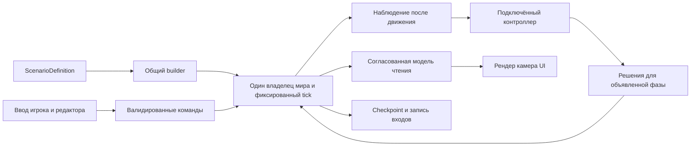

# Повторный анализ производительности игры и общего движка

Дата: 08.10.2026. Актуальная ревизия [исходного аудита](199-engine-performance-audit.md)
после изменений 201–214. Исполняемый порядок работ находится в
[основном плане](200-engine-performance-plan.md). Игровой код и данные в этой
ревизии не изменяются; выводы относятся к зафиксированному рабочему дереву.

## Главный вывод

Бой с ИИ становится дорогим прежде всего из-за движения, разрушения и
накопленной материи. Непосредственный выбор приказов ИИ занимает примерно
**0,016% headless-тика**. Его ускорение не решает нынешнюю проблему кадра.
Игровой `blast` всё ещё синхронно исполняет симуляцию в Update, затем готовит
изменившееся изображение. Работа над общей границей движка остаётся нужной,
но новый command owner и replay пока используются стендом, а не окном игры.

Средний headless-тик на актуальном коде — **13,149 мс**, поздний — **16,570 мс**.
Это заметно меньше исторических 17,5/22 мс до серии исправлений. Однако в конце
того же боя остаются **2 915 882 записи валки**, **2 013 153 записи обрушения**
и **39 495 фрагментов**. Последний submit обрушения произошёл на тике **164**
из 3600. Следовательно, скорость уже улучшалась, а устойчивое продвижение
всех физических работ ещё не достигнуто.

Свежая ordinary native-пара даёт **70,87 / 68,37 FPS**, p99 кадра
**33,616 / 35,393 мс**. Оба запуска выполнили 3600 тиков за 120 секунд и
достигли прежнего physical hash. Поэтому прежний вывод о недоборе 30 Hz
больше не относится к этой обычной паре, но цель плавности не достигнута.

Следующие результаты должны быть видны в игре: независимый от тика кадр,
ограниченная цена публикации, продвижение повреждений и разрушения при
насыщении физической вместимости. Полный журнал команд не должен становиться
бесконечной последовательностью подготовительных изменений, откладывающей
работу над чтениями рендера и физическими очередями.

## Что подтверждают актуальные измерения

За основу CPU-разбора взяты два последовательных candidate-прогона 214:
60 юнитов, 3600 тиков, 8 physics и 8 navigation workers. Проверены SHA256 всех
**374** входов того паспорта: текущие файлы совпадают. Бинарник стенда,
qualification и test log также связаны хешами. В этой ревизии CSV агрегированы
повторно с правильной кратностью фаз, без сложения дочерних scopes с родителями.

Артефакты нового разбора находятся в `out/engine-review-20261008/`:
`evidence.py`, `verified-headless.json`, `headless-summary.json`, `native-summary.json`, исходные
паспорта сборки и результаты графических запусков. Исходные CPU CSV сохранены
в `out/engine-fixes-20261008/ai-decision-replay/`.

| Величина | Значение | Что она означает |
|---|---:|---|
| Mean tick, два прохода | 13,179 / 13,120 мс | Полный headless step с наблюдателями стенда |
| p99 tick | 19,581 / 19,556 мс | Хвост CPU-шага, не p99 кадра |
| Max tick | 34,094 / 35,825 мс | Отдельные шаги длиннее периода 30 Hz |
| AI scope | 2,009 / 2,166 мкс на тик | Выбор решений в фазе, усреднённый по всем тикам |
| Физический hash | `5dd0c782d2b2f557` | Прежний результат боя, живых 26/21, базы 100/100 |
| Покрытие фазовыми интервалами | 98,44% | Остаток не объявляется ожиданием или mutex |

При частоте решений раз в 15 тиков средняя цена одной активной AI-фазы
порядка 30–32 мкс; это оценка из кратности, не отдельное измерение latency
контроллера. Политика, выполнение приказа, поиск маршрута, стрельба и урон —
разные виды работы. Дешёвая политика не означает дешёвый бой.

### Какие части тика теперь самые дорогие

Средние двух проходов, округлены. В таблице верхнего уровня нет повторного
учёта ног, маршрутов и лазерного halo внутри родительских фаз.

| Фаза | мс на тик | Доля |
|---|---:|---:|
| Движение | 4,953 | 37,67% |
| Физика обломков | 2,480 | 18,86% |
| Построение карты завалов | 1,444 | 10,98% |
| Боевые волны | 1,326 | 10,09% |
| Heat flush и применение правок | 0,944 | 7,18% |
| Обработка приказов и наведения | 0,533 | 4,06% |
| Обмен теплом | 0,482 | 3,66% |
| Полёт боеприпасов | 0,231 | 1,75% |
| Горение юнитов | 0,201 | 1,53% |
| Выбор приказов ИИ | 0,00209 | 0,016% |

Движение включает около **2,747 мс маршрутов**, **1,033 мс последовательного
commit**, **0,626 мс ног** и **0,192 мс валки**. Эти значения нельзя прибавлять
к 4,953 мс ещё раз. Нынешняя доля волн около 10%, поэтому прежние 25,43%
из аудита 199 больше не описывают актуальный профиль. Локальные индексы и
пропуск ненужной геометрии уже принесли пользу; повторять их как новые задачи
не нужно.

### Почему поздний бой тяжелее раннего

| Тики | Средний tick, мс | Фрагментов | Валка | Обрушение |
|---|---:|---:|---:|---:|
| 1–600 | 8,934 | 9356 | 232256 | 478543 |
| 601–1200 | 10,698 | 16490 | 840779 | 749475 |
| 1201–1800 | 12,899 | 22906 | 1281837 | 961081 |
| 1801–2400 | 14,051 | 27831 | 1485345 | 1353235 |
| 2401–3000 | 15,745 | 34234 | 2208376 | 1748472 |
| 3001–3600 | 16,570 | 39495 | 2915882 | 2013153 |

Живых бойцов становится меньше, но мир хранит всё больше физических
последствий. В последнем 600-tick окне валка получила **749097** arrivals,
retired **41591** записей и физически released **3817** клеток; отказ
вместимости отмечен **598** раз. Arrival/retired здесь — счётчики записей,
released — отдельная полезная работа. Их нельзя выдавать за одинаковые единицы
или автоматически считать повторные `(position, seed)` лишними дублями.

Наблюдение за возрастом текущей головы валки не равно возрасту самого старого
запроса во всём наборе: смена головы обнуляет наблюдение. К концу оно равно
9 тикам и не опровергает многомиллионную очередь. У обрушения непрерывный
blocked interval — **3436 тиков**, около **114,5 игровых секунд**.

## Актуальный графический профиль

Последовательно выполнены два ordinary запуска и один отдельный camera tour
по 120 секунд. Native собран `--locked --offline --release`; **388** входов
совпали до сборки, после неё и после измерений. Binary SHA256:
`30C954EB5B24F0BDE1C0B71F951B205AE30CF48DA457C7C4756D0BBAF46AF4D2`.
Среда: Ryzen 9 9950X3D, RTX 5090/Vulkan, 1600×900, focused, Windowed,
AutoNoVsync; фактические pools — 8 physics / 8 navigation / 4 compute.
Паспорт фиксирует локальные inputs и toolchain, не независимую пересборку SDK
и всех registry dependencies. Сборка успешна, исходники и данные не менялись.

| Режим | FPS | p99 кадра, мс | Max, мс | Тиков | Темп | За бюджетом 6,061 мс |
|---|---:|---:|---:|---:|---:|---:|
| Ordinary 1 | 70,87 | 33,616 | 48,995 | 3600 | 0,99956× | 5602 / 8507 |
| Ordinary 2 | 68,37 | 35,393 | 82,566 | 3600 | 0,99961× | 5442 / 8205 |
| Diagnostic + camera | 67,02 | 37,937 | 53,355 | 3564 | 0,98931× | 5420 / 8045 |

Все три evidence reports валидны; только ordinary-пара допускается к FPS
приёмке, и оба запуска **не проходят** цель 165 FPS. Малое отклонение обычного
темпа от 1 связано с границами измерения, rate gate пройден. Диагностический
режим включает CPU/core/render/GPU наблюдатели и другую работу камеры:
его разницу нельзя объявлять чистой ценой камеры или диагностики по отдельности.
Его final hash снят на тике 3564, поэтому не сравнивается с hash тика 3600.
Исторические 50,17 FPS из 199 относятся к версии до 201–214; новая пара
обновляет baseline, но не является одновременным A/B какого-то одного изменения.

### Кадры с тиком и без тика

В ordinary 1 средний begin-to-begin интервал без шага — **6,191 мс**
(Update 1,206 + следующий gap 4,985); с шагом — **24,907 мс**
(Update 21,047 + gap 3,859, включая 14,971 мс core внутри Update).
В ordinary 2 соответствующие интервалы — **6,138 / 25,491 мс**;
core — 15,313 мс на шаг. Шаговые интервалы занимают 74,7–76,4% измеренного
времени. Это прямое подтверждение связи кадра с симуляцией. Даже средний
интервал без шага немного выше бюджета 165 FPS: один sim thread сам по себе
не доказывает достижимость цели без работы над рендером и публикацией.

Интервал связывается с **предыдущим** Update и следующим gap, а не с текущей
строкой Bevy delta. У ordinary 2 последняя измеренная slice содержит один
шаг без следующего интервала: 3599 шага в cadence groups и 3600 всего не
противоречат друг другу. Gap не является доказанным GPU или mutex wait.
Пик 82,566 мс связан с предыдущим core 59,725 мс, но без подробных scopes
обычного запуска его внутренняя причина не установлена.

### Публикация камера и видеокарта

Диагностика сохранила все **3564** core ticks и **104585** render spans,
drop/incomplete — 0; один терминальный source row не имеет завершённого
следующего render прохода. Все 21 сегмент camera tour пройдены, blocked
frames — 0. Значит, нынешнее движение камеры не останавливает симуляцию
старым streaming gate, но оставляет дорогую публикацию:

- 26 camera publish операций: mean **5,519 мс**, max **11,207 мс**;
  внутри occupancy mean **3,621 мс**, max **9,359 мс**.
- Самый дорогой gas extract — **6,587 мс**: 207556 dirty ranges,
  111869 patches, 5440554 words; range **3,138 мс**, packing **3,429 мс**,
  clone **0,018 мс**. Связанный upload — **23153068 bytes**.
- Пики отдельных счётчиков за весь запуск: **262804 ranges**, **244583 patches**,
  **5507034 words**, terrain upload **23517984 bytes**. Они не обязательно
  относятся к одному кадру. Сумма terrain transfers — **8,716 GB**;
  это не VRAM, не peak resident memory и не измеренная пропускная способность PCIe.
- Есть и upload span **22,128 мс** при всего **32524 bytes**. Значит,
  уменьшение байтов не объясняет каждый хвост: для этого события нужны
  driver/scheduler evidence. Нулевой coarse CPU delta не доказывает GPU wait.
- GPU timestamp выборка содержит 5691 наблюдение основных проходов из
  8046 main rows. `terrain-colour` p99 **3,397 мс**, `gas-base` **1,531 мс**,
  отдельные gas regions — до **2,698 мс p99**. Это затраты проходов, а не
  полный GPU frame; их перцентили нельзя складывать или считать общий GPU
  bottleneck доказанным без корреляции с кадром.

Средняя загрузка процесса по OS CPU — **2,90 / 2,91 эквивалента ядра**
в ordinary и 3,01 в диагностике. Это не число постоянно занятых workers;
серийные интервалы и короткие jobs мешают автоматически загрузить все ядра.
Увеличивать pools без отдельной матрицы размеров задач недостаточно.

Новые результаты добавляют два обязательных пункта приёмки EP-10: ограничить
publication/occupancy spikes и стоимость ranges/packing, а оставшиеся редкие
driver/scheduler хвосты исследовать отдельно. Представление не должно тормозить
физический commit; допустимое визуальное отставание имеет измеряемый возраст.

## Причины и общий способ исправления

### Кадр ждёт симуляцию и её публикацию

[`Scene`](../../crates/render/src/bin/blast.rs) продолжает хранить `BlastRange`.
`advance` вызывает `profile.step(&mut scene.sim, generation)` синхронно.
После шага выполняются terrain updates, occupancy и эффекты. Мягкие 4 мс
догоняющего пакета проверяются между шагами; первый шаг всегда целый.
Шаг в 13–20 мс уже длиннее бюджета кадра 6,061 мс для 165 FPS или 6,25 мс
для 160 FPS. Это структурное ограничение кадра, даже когда 30 Hz симуляции
в среднем обеспечиваются.

Решение: один постоянный владелец mutable-мира и immutable модель чтения.
Сначала перевести все чтения и изменения UI на эту границу синхронно,
измерить цену экспорта позднего мира, затем переносить владельца на поток.
Общий mutex вокруг полного тика или копия полного save на каждый тик
сохранят проблему ожидания либо создадут большой memory/CPU overhead.

### Вместимость материи превращает разрушение в ожидание

В [`range_matter`](../../crates/sim-core/src/range_matter.rs),
[`burst`](../../crates/sim-core/src/burst.rs) и боевых волнах место резервируется
до удаления геометрии. Это необходимо для сохранения материи. Штатные caps:
4096 flying, 32768 working, 131072 resting fragments, 16 waves.
При насыщении полезный commit ждёт, а часть обходов и повторов продолжается.

Уже есть локальный/фазовый reuse вместимости, fairness волн, saved cursors,
индекс корпусов и исключение ненужных narrow-phase maps. Остаточная задача —
единый контракт ресурсов и событий готовности: spawn, settle, park, wake,
merge/retire, claims, thermal reserve и ownership. Не одна глобальная очередь
ради архитектуры, а понятные причины ожидания и условия освобождения.

Для current workload нужны два разных результата: сократить доказанно
бесполезные retries с прежней семантикой и обеспечить продвижение там, где
сама старая последовательность голодает. Второе меняет поведение и требует
нового боевого baseline. Поднять caps или удалить материю — не доказательство
устойчивости. Даже после прекращения огня конечный pool не обязан освободиться
без реального пути размещения, уплотнения или завершения начатой транзакции.

### Обрушение и валка требуют разных изменений

[`collapse_backlog`](../../crates/sim-core/src/blast.rs) ждёт глобального
отсутствия работающих волн, claims и некоторых source digs. Когда guard
снимается, накопленный пакет передаётся целиком. Нынешние 0,07 мс collapse
в среднем отражают в основном заблокированную работу. Удаление guard без
модели ownership может отделить одну клетку дважды или нарушить связность.

Нужны локальные транзакции связности и владения с согласованным commit.
Их приёмка включает действительно отделившиеся, упавшие и приземлившиеся
тела, цену нового mesh и публикации; нынешний заблокированный бой эту нагрузку
почти не показывает.

Валка хранит `BTreeSet<(position, seed)>` и прекращает обработку после первого
отказа вместимости. Лимит посещений за tick ограничивает затраты CPU, но не
поступление новых записей и не память. Нужны компактный фронт источников,
учёт посещённого и детерминированное обслуживание готовой работы. Любое
объединение записей должно сохранять распространение, ownership и стоимость
commit; простой `dedup` по клетке этого не гарантирует.

### Обслуживание спящей материи остаётся дорогим

[`refresh_rubble`](../../crates/sim-core/src/blast.rs) сначала строит новую
карту завалов и затем сравнивает её со старой. Избежать инвалидизации не значит
избежать построения. Несколько фаз `burst` по-прежнему собирают информацию по
историческому массиву fragments, даже когда полной динамики у многих нет.

Следующий общий механизм — устойчивые активные/спящие наборы и пространственные
данные, обновляемые при реальных переходах. Сохраняются source-order
`parked_end`, first-contact, thermal reservations, wake cadence и stable IDs.
Начинать нужно с измеренного полного gather/scan, а не заменять все массивы
новым деревом: roof-index и часть translation experiments уже не прошли
общий battle gate в 206/208.

### Навигация дороже самой политики ИИ

[`step_observed_all_tasks`](../../crates/sim-core/src/blast.rs) готовит общий
снимок препятствий, но затем собирает `others` для отдельных акторов/поисков.
Структура подготовки содержит квадратичную работу по числу юнитов.
Спекулятивные local hunts требуют проверки на актуальном пространственном
порядке commit; два корпуса не могут независимо занять одну щель.

Общий бюджет продолжений — 768, потолок на юнит — 192, новых поисков движения
за tick — 1. При 30 действительно новых дорогих поисках одна очередь допуска
уже может дать около секунды ожидания. Это не измеренный p99 команды:
прямой путь, повторное использование и стоимость searches различаются.
План должен измерять requested→assigned→first movement→visible отдельно.

Нужны spatial candidates общей фазы, переиспользование неизменной геометрии,
коридоры для групп и точный локальный swept contact. `road_waypoint` сейчас
заново собирает authored-road graph и ищет путь при вызове; static graph
можно хранить как общий ресурс навигации. Общее использование дороги не
должно зависеть от названия карты или от того, управляет ли юнитом игрок.

### Что осталось исправлять в ИИ

В [`Observation`](../../crates/sim-core/src/range_ai.rs) уже добавлены реальные
`attack_ranges`, `can_reposition`, alive/armed/mobile. Утверждение 199, что
таких данных нет, устарело. Но `Rules::decide` пока не использует
`in_weapon_reach` для общей фильтрации целей неподвижной установки. В конце
квалифицированного боя actor 26 остаётся на месте с `Attack(6)`, без destination.
Прежний вариант изменения выбора целей не прошёл полную проверку активности
армии; данные observation и решённое поведение — разные статусы.

Предвычисление focus-fire также уже сделано: support строится один раз на
актора, а не внутри оценки каждой actor–target пары. Прежнее утверждение о
кубическом вложенном сканировании больше неприменимо. Остаются квадратичное
сканирование союзников и целей, обращения к BTreeMap, поиск решения через
`.find` в `whole_plan` и при выборе supplied plan. На 60 юнитах последние
проходы малы; до снятия лимита 64 их нужно проверять на возрастающих rosters.

Общий путь поведения: дешёвая проверка способности действовать, выбор цели,
затем общий исполнитель с различимыми причинами отказа/ожидания. Дорогие
баллистика и pathfinding не запускаются для каждой пары в policy. Внешняя
модель получает versioned observation и посылает решения на объявленный tick;
её inference и wall clock остаются за пределами детерминированного kernel.
Частота decisions и hysteresis — данные контроллера, а не способ скрыть
дорогую физику. Отдельный поток нынешнему микросекундному Rules не нужен.

### Публикация изображения может остаться следующим ограничением

[`moving::occupancy`](../../crates/render/src/bin/blast/moving.rs) имеет кеши
геометрии/позы и parallel preparation, но строит/сравнивает объединение
занятых клеток и читает физический material при освобождении места.
[`fragments::draw`](../../crates/render/src/bin/blast/fragments.rs) использует
постоянные slots и `set_if_neq`, но продолжает обслуживать исторический список
фрагментов. Значит, «перестать пересоздавать всё» — уже не точное описание
оставшейся задачи. Нужны changed-ID/page updates и static/dynamic presentation.

[`witness`](../../crates/render/src/bin/blast/witness.rs) уже ограничивает mesh
jobs и опрашивает `poll_once`; это не синхронное ожидание полного rebuild.
При публикации остаются meshes/assets/entities и освобождение прежних данных.
Лимиты jobs необходимо дополнить байтами/вершинами, временем публикации и
возрастом видимой ревизии. Отдельно [`bodies::draw`](../../crates/render/src/bin/blast/bodies.rs)
ищет тела по списку и строит новые vertex/index buffers синхронно: массовое
разблокированное collapse должно проверить и этот путь.

[`gas`](../../crates/render/src/gas.rs) обрабатывает dirty ranges, packing и
GPU upload, включая создание временных ресурсов. Свежий профиль выше
подтверждает оставшуюся стоимость и массовых changes, и отдельных коротких
по объёму upload calls. GPU-проходы, render schedule и main Update пересекаются;
нельзя складывать их p99 или объявлять весь gap временем видеокарты.

## Насколько решение уже общее

| Механизм | Состояние сейчас | Требуемая граница |
|---|---|---|
| Сценарные RON | Во многом уже начальные данные | Только мир, entities, owners/controllers, декларативные цели и начальные события |
| Физика разных расстановок BlastRange | В основном общая | Один контракт для одинаковых мира/команд независимо от adapter |
| Команды игрока и ИИ | Общий handler, Outcomes, synchronous owner в 209–214 | Все product writers проходят через owner, без mutable world у frontend |
| Графический клиент | `Scene.sim`, прямые чтения и изменения | Read model + sender + явный lifecycle |
| Стороны | `layout.units[id].allied` | Runtime team/owner с устойчивой identity |
| Миссия | Base включает особые условия конца боя | Общий objective evaluator, отдельно от физического типа объекта |
| Одиночная пушка | Отдельный gun/fire/step path, варианты FAIR | Обычная сущность, общие weapon/command/admission rules |
| Старый `sim_core::World` | Отдельные Units, PHASES, combat/navigation/save | Поэтапная миграция потребителей и полезных служб без третьего kernel |
| Масштаб | Текущий playable loader ограничен 64 | Последовательная квалификация 128/256/512/1000/5000 на том же физическом пути |

`BlastRange.world` — `voxel::World`, а не вложенный `sim_core::World`.
Поэтому успех старого массового benchmark не доказывает работу 5000 сложных
боевых машин в окне `blast`. Общность механик и поддержка большого масштаба
проверяются отдельно. Переименование `range` в `engine` этого не меняет.

Целевой путь:

Это схема владения, не требование нового crate или отдельного потока для
каждой стрелки. Controllers выбирают намерения; правила движения, наведения,
допуска урона и сохранения принадлежат kernel. Scenario adapter не выбирает
особые budgets/physics flags для прохождения benchmark.

Синхронный CommandRuntime сейчас принимает уже начатый Fighting battle.
Setup, placement, смена оружия/шасси, knobs, одиночные fire/aim, pause/reset,
начало/конец боя ещё нуждаются в общей границе. В `knobs::apply` есть реальные
мутации motion, tuning и materials. Перевод только Move/Attack на sender
не даст безопасного отдельного владельца.

Геометрия, terrain pages, крупные тела, shield/weapon effects, command
receipts и selection — обязательные consumers read model. Одного массива
поз недостаточно: иначе renderer вернётся к чтению mutable kernel ради
повреждений и occupancy. Публикация должна иметь generation, tick и согласованные
revisions; старый mesh после reset не может воскресить удалённую сущность.

## Память сохранение и цена replay

Поздний physical snapshot на тике 3300 — **134186763 bytes**; owner checkpoint
с внешними whole plans — **140888673 bytes**. Копирование и уничтожение таких
буферов требуют отдельного lifecycle-бюджета. Полный save не подходит как
ежетиковое render message. Прямое применение COW также не гарантирует экономии:
нужно измерить dirty bytes, копии страниц, количество удерживаемых поколений
и место, где освобождается последнее владение.

В 214 добавлены portable AI frames, но strict diagnostic replay считает
полный owner hash перед AI-step. На позднем мире весь такой step занимает
около **414 мс**. Сам кадр решений занимает **814 bytes**. Основной дефект
этого режима — полная сериализация большого состояния для проверки, а не
размер списка решений. **Обычный product tick этот режим не вызывает**;
он не объясняет текущие фризы игры и не должен включаться как production log.

Рабочий журнал требует компактного порядка epoch/ordinal/tick/phase,
ограниченного sink и резервирования места до принятия authoritative работы.
Полные hashes/checkpoints остаются отдельными контрольными границами.
Замена full-state hash цепочкой входов меняет гарантию: цепочка доказывает
порядок входов, но сама не доказывает равенство физического состояния. Поэтому
проверки состояния сохраняются на явно выбранных границах, а strict offline
режим остаётся самостоятельным oracle.

Для долгого боя нужны memory high-water по world/units/fragments/queues,
nav scratch, presentation generations, GPU allocations и save transient peak.
В свежих ordinary процессах sampled peak private bytes — **7,916 / 7,892 GB**,
working set — **5,021 / 5,019 GB**. В diagnostic — **9,118 / 6,003 GB**
соответственно. Это пики всего процесса, включая запуск/завершение и служебные
буферы; они не означают такой размер авторитетного мира или утечку.
Один render trace резервирует 211411200 bytes, другие наблюдатели также
увеличивают память. Нет breakdown аллокатора, точного transient peak между
OS samples, свежей VRAM residency и OS pressure trace; эти пробелы остаются
в EP-11a и не заменяются суммой GPU transfers.
30 минут soak и reset/save/load cycles ещё не заменены 120-секундным боем.
Для большой карты отдельно требуется страничный authoritative world:
render window не уменьшает плотную память физики. Прежняя расчётная оценка
только bits+ceiling для 10000×192×10000 — около 2,43 GiB, не фактический RSS
полного игрового процесса.

## Надёжность границ и проверок

Последний квалифицированный source имеет **886 passed, 0 failed, 6 ignored**
в nav/sim-core; 9 полных боёв и два независимых file replay прошли. Это
проверки конкретного профиля и изменений, а не доказательство всего масштаба,
долгого soak или отсутствия редких аппаратных различий.

Architecture harness имеет четыре прежних failures, но их нужно разбирать
по причинам, а не механически заменять все найденные конструкции:

- Реальный float участвует в создании дорожного рельефа в `blast.rs`. Это
  риск воспроизводимости начального мира, даже если не горячая фаза тика.
- В clock failure перечислен `Instant` в тесте измерения волн. Он не
  доказывает, что gameplay decisions принимаются по wall clock.
- HashMap в поиске используется для lookup, save сортирует reached IDs;
  merge собирает пары в source order и сортирует donors; SettledQueries —
  membership mask без обхода таблицы ради порядка commit. Каждый unordered
  обход требует проверки, но замена всех lookup maps на BTreeMap без причины
  может ухудшить скорость и не исправить реальную границу.
- Regex render-write checker включает test fixtures и ложные совпадения
  вроде match guard с `=>`, одновременно не гарантируя обнаружение всех
  изменений через переданный `&mut`. Реальные product writers подтверждены
  отдельно в advance/panel/knobs/workbench.

Основная защита — типы, владение и differential checks. Линт следует уточнить
под production/test/diagnostic пути с явными разрешёнными контрактами, сохранив
запрет реальных обходов. Четыре failures не объявляются исправленными этой
ревизией, и их число не используется как мера FPS.

## Что изменено в приоритетах плана

1. Актуализировать baseline и остановить повторное внедрение уже сделанных
   кешей, данных observation и focus-fire preprocessing. Старые цифры
   сохраняются как история с датой и версией.
2. Вести два самостоятельных направления: связь кадра с симуляцией и прогресс
   физики. Read model/writer inventory можно делать сейчас; они не ждут
   завершения durable journal. Admission/queue work также не ждёт sim thread.
3. Для ближайшего вертикального среза продуктового пути собрать все writers
   и readers, реализовать синхронную модель чтения, измерить export на позднем
   мире, затем перенести owner и проверить frame/tempo/latency/lifecycle.
4. Для физики выбрать конкретный blocker или исторический scan, показать
   полезные commits, возраст/размер очереди и цену полного тика. Успех не
   определяется низким временем заблокированной фазы.
5. Перед production journal убрать full world hash из каждого AI deadline,
   сохранить проверяемые state boundaries и явную семантику переполнения.
   Диагностика, подтверждения commands и presentation ack — разные потоки.
6. Проверять общность уже на небольших сценариях: тот же созданный мир,
   rules и команды дают то же canonical state через разные adapters.
   Миграцию legacy World и 5000 юнитов вести после работающего малого пути.

Повторная проверка охватывает связку CPU tick, AI/приказы/навигация,
оружие/тепло/материя, admission/felling/collapse, мелкие и крупные тела,
render publication/camera/GPU, память/save/reset, сценарные зависимости
и достоверность измерений. Остающиеся неопределённости привязаны к приёмкам
этапов, а не превращены в обещание фиксированного процента ускорения.
