# 321 — Сводный аудит производительности и архитектуры

**18.10.2026; код `main 509507f`.** Результат: проверены текущее тяжёлое
поведение, концептуальные причины и направления оптимизации; рабочая
очередь сведена в [единый план316](316-optimization-delivery-plan.md).
В этом изменении нет новой физики, баланса, зависимости или обещанного
ускорения игры. Изменяются документация и её организация.

## Основной вывод

Игра тормозит не потому, что ИИ долго выбирает приказ, и не только потому,
что материал состоит из кубиков. Дороги **повторные запросы и построение
производных структур по накопленной истории**, очереди разрушений,
составные пики взрывов и экранные GPU-проходы. Синхронный SIM внутри
Main Update превращает задержку расчёта в задержку кадра.

На текущем бинарнике:

- Весь headless SIM:18,088 мс в среднем, p9944,849, max106,125 мс.
  Завалы, движение и обломки —78,6% среднего,83,0% позднего шага.
- Обычный maximized World240:36,6 FPS в среднем, p99 кадра59,849 мс;
  по минутам58,4→35,0→28,2→24,9 FPS.30 Гц не удерживаются.
- После прекращения новых выстрелов физика продолжает стоить17,065 мс/тик;
  за60 игровых секунд остаётся1,553 млн запросов валки.
- В GPU-диагностике gas raymarch4,760 и terrain3,697 мс на наблюдаемый
  publication batch; gas compute всего0,215 мс. Это другой предел,
  который ускорение SIM само по себе не снимает.

Следующий главный точный кандидат — сохраняемая геометрия/членство опор
завалов (OPT316-04a), затем зависимости опор и active sets. Параллельно
по смыслу исследуются progress валки, bulk apply взрывов и законченная
публикация SIM→render. Тяжёлые измерения выполняются последовательно.

## Что именно пересмотрено в документации

Полнотекстовая инвентаризация охватила **333 Markdown-файла**,9 538 245 байт,
101 020 строк исходного корпуса. Для каждого сохранены название,
структура, размер, hash и открытые вопросы. [Реестр](321-document-map.csv)
фиксирует **входной срез**, поэтому новые321/README и последующие правки
не обязаны совпадать с его hashes. Это статическая проверка всего корпуса,
а не утверждение о построчном ручном ревью всех101 тысяч строк.

Содержательно повторно разобраны канон/инварианты, текущий runtime,
поколения performance-планов и их контрпримеры. Карта покрытия:

| Источники | Что учтено / куда сведено |
|---|---|
|01,02,03,13; CLAUDE.md| Скоуп, детерминизм, фазы, CPU authority, публикация; ограничения всех OPT316 |
|04,05,06,15| Мир, материальные тела, navigation, damage, опоры, волны;02–06 |
|07,08,09| Ledger/стоки, процедурная база, data/mod contracts;03/09/10 |
|10,11,12,14 и полный ADR-реестр| Бюджеты, этапы, принятые решения, сцены; нормы остаются по своим владельцам |
|04 analysis;31/118;199/200;215/238/239/240/242| Старые playbook/backlog/EP/WBPERF и обязательства; таблица соответствия316 |
|241/276/277/280/281| Parallelism, approximations, rejected experiments и ошибки прежних предложений |
|245–249| Неполный перенос экономики, placement и масштаб; специализированные механики245, performance316-10 |
|263/274/279/302/310/314/315| Профили, coverage,26 сценариев, архитектура; исторические данные с датой/backend |
|282–293;303–305;311| Реализованные индексы/буферы/маски и исправления; не предлагаются как новые |
|317–320| Cache lifetime, bounded read-ahead, ground/capture columns уже внедрены |

Найдено36 дословных крупных общих блоков;35 сведены к одному тексту с
адресными ссылками, **73 повторные копии удалены**. Повтор самостоятельной
команды воспроизведения оставлен намеренно. Уникальные результаты,
контрпримеры, ADR и адреса старых файлов сохранены.25 старых обзоров/планов
явно архивированы. Таблицы очередей314/315 заменены ссылкой на316,
перегруженная актуализация roadmap сокращена до навигации.

Теперь: **канон — правила;316 — единственный актуальный план;321 — текущий
аудит; номерные отчёты — свидетельства отдельных изменений; ADR — принятые
решения**. [Вход](../README.md) связывает эти роли. Старый «текущий golden»
в архиве относится только к его ревизии. Цифры5000 юнитов старого `World`
не подтверждают масштаб `BlastRange`. Начало10-budgets уточнено: наличие
цели не равнозначно работающему зелёному CI gate.

## Методика и происхождение свежих измерений

Origin/main обновлён, перед работой совпал с509507f. Проверены все497
runtime source/data fingerprints из320. Повторно использованы те же
замороженные release binaries; новой сборки другого кода нет.

| Исполняемый файл | SHA-256 |
|---|---|
| bench_battle | `15dba77a432367a77a9fa8020b6700b32973d77ace99465bd0f48177458f49aa` |
| blast | `099dc157061e157561b5be8cd0ab5d8385b4c4d5cdf329f7dfa1a7914d4dc805` |
| sim-cli | `08bc31500bfb806109840c857ccd07fadeea3c36f59d50771c3e52bf139d39ea` |

Это content provenance, не отдельная аттестация toolchain/clean build.
Stock World AI-vs-AI,62 стартовых актора,physics4/nav8/Rayon4; native
Bevy Compute4,Vulkan,RTX5090,3840×1949,scale1,focus=true,AutoNoVsync.
Headless6000+drain1800, ordinary native240 и отдельный GPU/core90 прошли
последовательно. Native — maximized Windowed, не exclusive fullscreen.
Исходники/данные игры во время работы не менялись.

Один свежий headless повтор и один ordinary native — проверка текущего
состояния, **не парное before/after ускорение**. Трассировка GPU/core не
квалифицирует обычный FPS. Новый headless повтор совпал с320 на каждом
из6000 тиков по всем36 нетайминговым CSV-полям; итоговый hash
`21bef878463f364c`. Это не равенство всех промежуточных serialized bytes.

## Время SIM: среднее и хвосты

Таймеры верхнего уровня — последовательные завершённые интервалы.
Проверено для каждой строки: сумма известных фаз≤observed≤root;
остатки учтены отдельно, итоговые доли дают100%. Вложенные felling/routes
входят в motion; их нельзя добавлять к этой таблице.

| Фаза | Mean мс/тик | Доля | p99 мс | Max мс |
|---|---:|---:|---:|---:|
| Карта завалов/контакты обломков |5,247|29,01%|8,504|29,636|
| Движение/навигация/валка |4,530|25,04%|13,312|18,290|
| Debris/останки |4,436|24,52%|6,810|26,141|
| Collapse/правки мира |1,657|9,16%|5,328|11,315|
| Применение боевых волн |0,581|3,21%|14,732|34,438|
| Frontier/подготовка контактов |0,371|2,05%|8,405|38,737|
| Применение тепла |0,216|1,20%|1,942|5,801|
| Полёт боевых снарядов |0,199|1,10%|1,033|4,079|
| Приказы/прицеливание/стрельба |0,176|0,98%|1,346|14,218|
| Горение юнитов |0,164|0,91%|0,366|0,796|
| Capture сопротивления |0,138|0,76%|4,780|24,947|

Полная таблица, включая малые фазы/остаток и отдельные окна, —
[321-performance-ranking.csv](321-performance-ranking.csv).
Максимумы фаз не складываются: происходят на разных тиках.

| Окно | Mean мс | p99 мс | Max мс | Тиков>33 мс |
|---|---:|---:|---:|---:|
|1–6000|18,088|44,849|106,125|151|
|1–600|8,765|46,478|71,910|7|
|2401–6000|20,755|43,597|97,673|78|
|5401–6000|21,728|29,569|42,613|3|

Поздно растёт базовая цена, хотя взрывы уже реже. В последнем окне почти
нет залповых пиков, но rubble7,683 и debris6,112 мс/тик остаются.
Большой p99 раннего окна и больший mean позднего — не противоречие.

Худший tick2227:106,125 мс; capture19,334 + frontier34,268 + apply24,747
=78,349 мс только эти три последовательные фазы. Остаток не исчезает
от ускорения одной из них. После320 прежний одиночный capture≈109 мс
уже устранён; диагноз «всё ещё медленный capture» теперь неверен.
Одиночные rubble/debris выбросы этого повтора не локализованы до CPU/OS
причины и не объявляются новой алгоритмической регрессией.

## Прекращение новой нагрузки: свежий drain

Существующий `bench_battle/drain.rs` принудительно переводит бой в Setup,
отдаёт Hold и очищает маршруты. Авторитетная физика, старые waves/rounds,
heat/collapse/debris сохраняются; код проверяет отсутствие новых выстрелов
и ledger. Это **диагностический fixture**, не штатная кнопка паузы.
В первом же шаге6001 rounds/waves/kinetic уже нулевые. Пассивные движения,
контакты и собственное распространение валки продолжаются.

| Показатель | Значение за1800 шагов /60 секунд SIM |
|---|---:|
| Очередь на входе |5 175 231 пар |
| Новые arrivals |3 091 214 |
| Visits, включая повторы |7 372 800 |
| Retired |6 713 043 |
| Фактически released клеток |715 415 |
| Capacity deferrals |669 306 |
| Очередь на выходе |1 553 402 |
| Fragment records до→после |69 002→61 646 |
| Flying на выходе |3 197 |
| Mean /p99 /max тика |17,065 /21,597 /31,453 мс |

Проверено равенство `start + arrivals − retired = end`. Retired пары,
released клетки и число деревьев — разные единицы. На выходе98 970 пар
указывают на yielding материал; остальные нельзя просто выкинуть из
точной оптимизации, поскольку visits тратят квоту и меняют сроки.
Итоговый hash tick7800: `9d708e36e40593e3`, это новый диагностический
исход, не golden и не сравнение с обычным продолжающимся боем.

Очередь уменьшается, но не завершилась. Это опровергает предположение
«всё дорого только пока стреляют» и поддерживает приоритет history/support
и очередей. **Не доказывает** вечный deadlock, starvation отдельного seed
или конечное время полного drain. Нужны более длинный drain, распределение
возраста и классификация удерживающих slots причин — они включены в03.

## Обычный native и экранная нагрузка

Ordinary World240 завершён штатно:8791 измеренный интервал,
240,0804192 с,6729 тиков,ratio0,934270,mean36,6 FPS,
p9543,689/p9959,849/max125,738 мс. ValidForComparison=true,
AcceptanceEligible=false **из-за провала темпа SIM**, а не из-за
подробной трассировки: она здесь выключена. Контрольный TargetFps120
не пройден;8538 интервалов также больше6,06 мс цели165 FPS.

| Wall окно | FPS по числу кадров | Core мс/фактический тик | Moving/fragments/bodies мс/кадр |
|---|---:|---:|---:|
|0–60 с|58,38|15,072|0,825|
|60–120 с|35,03|22,739|1,894|
|120–180 с|28,20|24,406|2,675|
|180–240 с|24,90|26,712|3,265|

Последний terminal row не включён в минутные полуинтервалы. Конечный долг
≈29 тиков, сумма dropped accumulator time442,300 тика,≈14,743 секунды.
Это списанное wall-время, не удалённые промежуточные физические тики.
На выходе75 748 fragment records и6 314 744 felling pairs; состояние
hash `355099ec2ce34ac0` относится кtick6729, его нельзя сравнивать с6000.

В отдельной90-секундной диагностике GPU/core получены3113 GPU publications
на4494 main rows;90 896 samples сохранены,invalid0/dropped0 внутри
коллектора. Доставка последних batches Bevy всё равно может пропустить
GPU кадры: source frame ID нет, полное GPU frame elapsed не измерено.

| Непересекающиеся GPU scopes | Mean мс/publication | p99 мс |
|---|---:|---:|
| Gas raymarch |4,760|11,114|
| Terrain |3,697|7,809|
| Прочие измеренные passes |0,892|1,231|
| Voxel postprocess |0,241|0,595|
| Gas compute |0,215|0,552|

Это измеренная работа scopes, не CPU time/загрузка GPU/FPS. Нельзя
прикрепить delayed publication к тому же CPU row и назвать причиной
конкретного фриза. Вывод ограничен: полноэкранный дым и terrain — сильные
самостоятельные кандидаты, даже после оптимизации физики.

## Архитектурный разбор под разными углами

### 1. Критический путь и степень связности

Фактическая схема, без обещания нового scheduling:

```mermaid
flowchart LR
    I[Приказы и fixed clock] --> M[Main Update]
    M --> S[Синхронный шаг BlastRange]
    S --> R[Полная подготовка rubble]
    R --> V[Motion: подготовка и ordered commit]
    V --> W[Волны: parallel capture / parallel read / ordered apply]
    W --> D[Collapse / debris / accounting]
    D --> P[Публикация и визуальные читатели]
    P --> G[Render Prepare / GPU / present]
```



Это упрощённый путь зависимости кадра, не полное расписание RenderApp:
внутри фазы есть workers, render pipeline перекрывает кадры.
`advance` проверяет мягкие4 мс только **между** тиками; уже начатый
106-мс шаг этим не прерывается. Даже20-мс SIM, укладывающийся в30 Гц,
мешает6,06-мс кадру. Нужно и сократить работу, и закончить границу
публикации. Off-thread owner без полного read model либо удерживает mutex
на весь tick, либо даёт несогласованные версии. Один thread не решает GPU.

### 2. Алгоритм: стоимость истории вместо стоимости изменений

`refresh_rubble` правильно сохраняет равный coarse cache после317,
но до сравнения **полностью** вызывает `current_rubble_with_scratch`.
В `burst::rubble_with_scratch` bounds/classify/support/columns строятся
снова. Выигрыш от reuse Vec не равен reuse результата.
`step_fragments_kernel` по-прежнему обслуживает множество retained records
и готовит `Settled::for_phase_into`. Сон отдельного куска не отключает
работу всех его потребителей. `fragments/dense::Slots::prepare` также
проходит по retained pieces, хотя часть поз не меняется.

Желаемая зависимость: active pieces + dirty providers + touched dependency
closure. Не обещаем O(dirty) во всех случаях: большой взрыв/потеря нижней
опоры может затронуть весь связный стек, а поддержание индекса стоит памяти
и времени. Поэтому сначала bounds/membership, затем ответы опор с full fallback.

### 3. Очереди и усиление нагрузки

Контакт→снятие клеток→несколько seeds→claims→pieces→опоры→навигация→меши
создаёт работу в нескольких подсистемах. Предел flying не ограничивает
историю, felling front или render records. Поднятый лимит может перенести
проблему дальше по цепочке, уменьшенный — спрятать её в задержку разрушения.

Нужны единицы useful work, repeated work и время от причины до результата.
Точное ускорение вычислений не меняет visits/tick, поэтому само по себе
не гарантирует меньше **игровых тиков** до падения дерева. Для progress
ограниченного квотой требуется отдельный пересмотр модели/расписания.
Документ316 отличает такую работу от побитно эквивалентного кэша.

### 4. Гранулярность и память запросов

У T3 крупная клетка поля покрывает много точных субклеток; fewer field cells
не значит меньше ground work.318 ограничил ненужную предвыборку,
319/320 переиспользовали X/Z подготовку генератора колонками.
Следующий кандидат — точные summaries/span operations и ordered apply,
а не усреднение материала или уменьшение радиуса. Семантика claim/energy
и реального снятия важнее числа вызовов функции.

Память сравнивать по владельцу: authoritative world, queue, scratch,
geometry, mesh assets, publication, driver. Старые8,40 GiB private bytes
из314 не доказывают leak и не являются свежим замером321. Snapshot219 MB
не равен heap. AoS→SoA, arena, SIMD, sparse tree — вторичные эксперименты
после cache/allocation evidence; заменять хорошие bit masks деревом
по названию «sparse» не обосновано.

### 5. Параллелизм и причинность

В текущем `range_battle` capture разных волн уже выполняется par_iter,
потом frontier+read тоже par_iter; apply идёт в canonical order.
Фраза320 о независимой подготовке волн уточнена: простой междуволновой
parallelism **уже существует**. Новая гипотеза могла бы касаться только
перекрытия разных стадий при прежних квотах и общей read visibility.
Доказательств выгоды ещё нет; опыт241 уже показывал отсутствие выигрыша
у части overlaps. Новые пулы не являются первым шагом.

Motion обновляет `positions[id]` после принятой позы. Следующий юнит
видит её, поэтому параллельный commit меняет проход группы. Spatial
index должен обновляться в этом порядке и сохранять actor IDs: нынешний
индекс контакта является позицией в полном `others` без self. Простая
подмена его компактным списком даст удар не тому юниту.

Исторический sweep314 physics1/2/4/8 ≈43,3/30,7/23,2/20,1 мс подтверждает
ограниченный выигрыш потоков, а не отсутствие параллельности. Это hot
headless другого среза, не выбор лучшего native default после320.

### 6. Границы точности и игрового качества

| Подход | Что доказать до внедрения | Вердикт |
|---|---|---|
| Bounds/occupancy/uniform summaries + exact fallback | Нет false negative, полная invalidation и прежний порядок | Сильный точный кандидат |
| Persistent support/column contributions | Все зависимости, следующий max после удаления, фазовые снимки | Сильный, но высокий риск корректности |
| Active/dirty lists | Не пропущены deadline/wake/evict/merge/reclaim | Сильный после полноты индекса |
| Группировка только render geometry | Picking, тени, материалы, отдельный физический ID | Допустима без изменения SIM |
| Более грубый/редкий дым | Depth/disocclusion, тонкие препятствия, визуальная ошибка | Отдельный визуальный опыт |
| Aggregate rubble/единая крона | Геометрия опор/укрытия, материальные контейнеры, сроки и баланс | Новая модель, не точный кэш |
| Финальная воронка заранее | Нет зависимости от движущихся тел, чужих waves, energy/slots/edits | В общем случае сейчас не доказано |
| Снизить AI frequency/30 Гц/радиус | Меняет реакцию/нагрузку, не устраняет найденную причину | Не использовать как performance fix |

### 7. Масштаб и единый продукт

Физика текущих миссий общая, но сценарные UI/headless adapters могут
дублировать оценку этапов. Если win/lose становится authoritative replay
состоянием, нужен общий evaluator, а не отдельная физика для миссии.
Сейчас это риск сопровождения, не измеренный CPU bottleneck.

`BlastRange` и старый `sim_core::World` нельзя смешивать в доказательствах
масштаба. Экономические continuations, placement многих фабрик, стройка,
fall damage/riders и полнота переноса остаются работой245/H3/H4.
Убрать `sim_core::World` не значит удалить `voxel::World` — это необходимое
хранилище актуального runtime. Стенд5000 должен запускать ту же материальную
модель с реальными повреждениями/добычей, а не простаивающие сущности.

## Валидация предложений и предел ожидаемого выигрыша

Проверены текущий call graph и уже внедрённые методы; свежие root timings,
drain и fullscreen/GPU подтверждают **выбор направлений**, а не работу
ещё не написанного кандидата. Старые неудачные опыты283/281 особенно важны:
evict расширяет область за подготовленный sweep; мало изменившихся heights
не означает мало provider updates; неизвестная граница collapse не bedrock.
Эти случаи включены в приёмку316 вместо слепого «кэшировать всё».

Условная оценка с неизменными остальными фазами:

- Если только rubble станет вдвое дешевле, late mean20,755→17,184 мс,
  максимум≈1,21× по среднему SIM, **не2× всей игре**.
- Если все три главные фазы станут вдвое дешевле, late mean≈12,142 мс,
  весь mean≈10,981 мс. Это арифметический сценарий, не прогноз и не p99.
- Даже12-мс средний синхронный шаг не даёт6,06-мс кадра. Нужна08;
  GPU-расход остаётся независимо. Проценты отдельных опытов не складываются.

| Гипотеза | Степень подтверждения | Что может её опровергнуть |
|---|---|---|
| Повторная история опор — главный late расход | Код + fresh mean/drain | Maintenance индекса дороже полного rebuild на реальном dirty set |
| Очереди требуют отдельного progress-критерия | Fresh conservation/drain | Полный drain/age распределение покажут допустимые сроки всех классов |
| Bulk apply уменьшит залповые пики | Пик локализован; алгоритм ещё не испытан | Доминирует другая leaf-фаза или validation съедает gain |
| Off-thread SIM уменьшит блокировку кадра | Синхронный вызов доказан | Export/backpressure/CPU contention/GPU оставят frame tails |
| Gas skipping снизит full-window расход | Fresh GPU scopes, сильная зависимость от покрытия | Hierarchy update/composite дороже; неприемлемая визуальная ошибка |
| Local neighbors помогут масштабу | Явный all-roster loop в коде | При нынешних≤64 dominates terrain; index overhead превышает экономию |

## Покрытие профилирования и оставшиеся пробелы

| Область | Что есть | Чего ещё нет |
|---|---|---|
| SIM root/фазы | Additive bench, native steps/core/debt/drops | Hardware counters/стек каждого хвоста |
| Motion/nav/feet | Phase/unit/task scopes, latency стенды | Query reuse rate/dirty footprint для нового индекса |
| Waves/collapse | Capture/frontier/apply и внутренние stages, queues | Leaf apply attribution, costs на volume, age каждого job |
| Debris/rubble/felling | Counters/worker families, свежий drain | Live owners slots, полный age/capture и стоимость по типу фрагмента |
| Render CPU | Extract/Prepare, sampled named systems314 | Moving/fragments/bodies отдельно, mesh producer churn |
| GPU | Fresh published pass timestamps | Source GPU frame ID, полное elapsed, VRAM/occupancy/bandwidth |
| ОС/память | Process/thread samples, snapshots и counts | Heap allocation/free stacks, causal wait/ETW, долгий VRAM plateau |
| UI/start/save/load/reset | Функциональные сценарии/старые captures | Систематический cold/hot latency и долгие циклы текущего баланса |
| Экономика/масштаб/network | Ledger/replay, локальные стенды | Насыщенные линии/стройка5000; реальный сетевой transport |

В321 заново не проходились все26 сценариев, saved tuning, Linux,30-minute
soak,5000, длительный VRAM тест и визуальная ошибка будущего approximation.
Матрица314 сохранена как историческая; аналогичного текущего результата
не заявляем. Редкий1–2-секундный фриз не воспроизведён; отсутствие его в
этих захватах не доказывает устранение.

## Источники в коде

| Вывод | Файл / символ |
|---|---|
| Полная rubble до проверки равенства | [blast.rs](../../crates/sim-core/src/blast.rs): `refresh_rubble`, `current_rubble_with_scratch` |
| Повторные support и history scans | [burst.rs](../../crates/sim-core/src/burst.rs): `rubble_with_scratch`, `step_fragments_kernel`, `Settled::for_phase_into` |
| Порядок visits/seeds, capacity retry | [range_matter.rs](../../crates/sim-core/src/range_matter.rs): `spread`, `step_felling_with_room` |
| Уже parallel waves + ordered apply | [range_battle.rs](../../crates/sim-core/src/range_battle.rs): распределение `slices/pops/budgets`, `par_iter_mut`, `step_with_room` |
| Motion causal order/contact IDs | [blast.rs](../../crates/sim-core/src/blast.rs): `step_in_pool`, `positions[id]`, `others` |
| Capture columns уже исправлен | [range_capture.rs](../../crates/sim-core/src/range_capture.rs): `capture_inner` |
| Синхронный tick в кадре | [render blast](../../crates/render/src/bin/blast.rs): `advance` |
| Полная подготовка retained render pieces | [dense.rs](../../crates/render/src/bin/blast/fragments/dense.rs): `Slots::prepare` |
| Существующий задел owned API | [View](../../crates/sim-core/src/range_read_model.rs), [terrain](../../crates/sim-core/src/range_terrain_view.rs), [runtime](../../crates/sim-core/src/range_command_runtime.rs) |
| Диагностический drain | [drain.rs](../../crates/sim-core/src/bin/bench_battle/drain.rs): `quiesce`, `run` |
| Ограничение GPU attribution | [gpu_profile.rs](../../crates/render/src/gpu_profile.rs), [анализатор](../../scripts/range_gpu_profile.py) |

## Воспроизведение и проверки

Артефакты локально: `out/audit-321/`. CSV/log/manifests, исходная
инвентаризация, карта удалённых копий, анализаторы и checksums сохраняются.
Полные сырые native трассы не коммитятся; компактный воспроизводимый
[ranking](321-performance-ranking.csv) и реестр документов входят в Git.
Путь `out/optimization-320/after-*` означает проверенные выше binaries.

```powershell
$env:RAYON_NUM_THREADS='4'
./out/optimization-320/after-bench_battle.exe --world --ai-vs-ai --ticks 6000 --physics-workers 4 --workers 8 --tick-csv out/audit-321/world-6000.csv --drain-ticks 1800 --drain-csv out/audit-321/drain-1800.csv
# Для повторного запуска используйте новую выходную директорию.
./scripts/profile-range.ps1 -Seconds 240 -Scenarios world-battle -Output out/audit-321/native-world240 -SkipBuild -BinaryPath out/optimization-320/after-blast.exe -PhysicsWorkers 4 -NavigationWorkers 8 -RayonWorkers 4 -ComputeWorkers 4 -Maximized
./scripts/profile-range.ps1 -Seconds 90 -Scenarios world-battle -Output out/audit-321/native-gpu90 -SkipBuild -BinaryPath out/optimization-320/after-blast.exe -PhysicsWorkers 4 -NavigationWorkers 8 -RayonWorkers 4 -ComputeWorkers 4 -Maximized -Gpu -CorePhases -CpuThreads
```

Fresh harness release/locked/offline: architecture12/12, docs3/3.
Тесты анализаторов: additive audit9/9, GPU6/6, native profile135/135.
Проверены1251 локальная ссылка, новые и старые разрешаются; все35
сведённых текстов побуквенно сохранены с нормализацией пробелов,73 копии
заменены адресными ссылками. Арифметика фаз и очереди проверена скриптом.
Полные1008 SIM/171 voxel из320 — прошлые проверки того же исходного кода,
не новый запуск321. Fresh headless/drain и native перечислены выше.
Новая очередь не считается реализованной:
кандидаты принимаются только по процедуре316.
